# マイ漢字タウン つかいかた

## はじめに ― マイ<ruby>漢字<rt>かんじ</rt></ruby>タウンで できること

このページは、マイ<ruby>漢字<rt>かんじ</rt></ruby>タウンを はじめて ひらく人のための つかいかたです。
<ruby>画面<rt>がめん</rt></ruby>の 絵と 見くらべながら、上から じゅんに <ruby>読<rt>よ</rt></ruby>んでください。

### どんな アプリか

<ruby>小学校<rt>しょうがっこう</rt></ruby>で ならう <ruby>漢字<rt>かんじ</rt></ruby> 1026字を、
4つの力で おぼえる アプリです。
4つの力とは「<ruby>読<rt>よ</rt></ruby>み」「<ruby>意味<rt>いみ</rt></ruby>」
「<ruby>書字<rt>しょじ</rt></ruby>（字の かたち）」
「<ruby>筆順<rt>ひつじゅん</rt></ruby>（書く じゅんばん）」の ことです。

1字ずつ「<ruby>音読<rt>おんどく</rt></ruby> →
<ruby>書<rt>か</rt></ruby>き<ruby>順<rt>じゅん</rt></ruby> → なぞる → テスト」の
じゅんに すすみます。
おぼえた字は、しばらく たつと また 出てきます。わすれたころに もう一度 出るので、
おぼえたことが のこります。

<ruby>漢字<rt>かんじ</rt></ruby>を おぼえると、じぶんの まちに 人が ふえて、
まちが 大きく なります。
まちづくりは おまけです。やらなくても、<ruby>学習<rt>がくしゅう</rt></ruby>は
さいごまで すすめられます。

先生が つかう しくみも 入っています。<ruby>漢字<rt>かんじ</rt></ruby>を えらんで
じぶんの ドリルを 作り、リンクや QRコードで <ruby>学級<rt>がっきゅう</rt></ruby>に
くばれます（下の「マイドリルを 作って くばる」を 見てください）。
ドリルを しめきりつきの しゅくだいに したり、<ruby>授業<rt>じゅぎょう</rt></ruby>で ならった 字だけを
まいにちの <ruby>学習<rt>がくしゅう</rt></ruby>に 出す「ならった はんい」を 前もって くばったりも できます。

### つかう<ruby>前<rt>まえ</rt></ruby>に <ruby>用意<rt>ようい</rt></ruby>するもの

ひらく前に、つぎの ものを たしかめてください。

- インターネットに つながる <ruby>学習用<rt>がくしゅうよう</rt></ruby>の <ruby>端末<rt>たんまつ</rt></ruby>（タブレット・パソコン・スマートフォン）
- ブラウザー。Chrome か Safari を おすすめします
- ひらく ばしょ（アドレス）は https://kanji-town.giga-school.com/ です
- インターネットは さいしょの 1回だけ ひつようです。2回目からは なくても つかえます
- <ruby>音読<rt>おんどく</rt></ruby>チャレンジを つかうときだけ、マイクの きょかが いります

アカウントの とうろくや ログインは いりません。
<ruby>名前<rt>なまえ</rt></ruby>・<ruby>出席番号<rt>しゅっせきばんごう</rt></ruby>・
メールアドレスを 入れる ところが、そもそも ありません。

<ruby>学習<rt>がくしゅう</rt></ruby>の <ruby>記録<rt>きろく</rt></ruby>は、その
<ruby>端末<rt>たんまつ</rt></ruby>の 中だけに のこります。<ruby>外<rt>そと</rt></ruby>へ
<ruby>送<rt>おく</rt></ruby>られません。
<ruby>音読<rt>おんどく</rt></ruby>チャレンジの <ruby>声<rt>こえ</rt></ruby>も、
ろくおんも ほぞんも そうしんも しません。
ドリルの やりとりも、あいだに サーバーを <ruby>通<rt>とお</rt></ruby>しません。

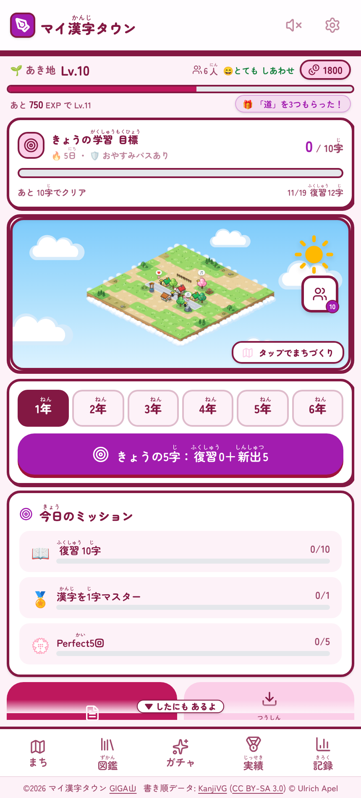

これが ホームの がめんです。

## さいしょに ひらいた日に すること

はじめて ひらいた日だけ、みじかい あんないと <ruby>学年<rt>がくねん</rt></ruby>えらびが あります。
2回目からは、いきなり ホームの<ruby>画面<rt>がめん</rt></ruby>が 出ます。

### あんないを <ruby>読<rt>よ</rt></ruby>む、または とばす

アプリを ひらくと、さいしょに あんないが 出ます。
「つぎへ」を おすと <ruby>先<rt>さき</rt></ruby>へ すすみ、「スキップする」を おすと とばせます。

とばしても、あとから こまることは ありません。
この つかいかたのページに 同じことが 書いてあります。

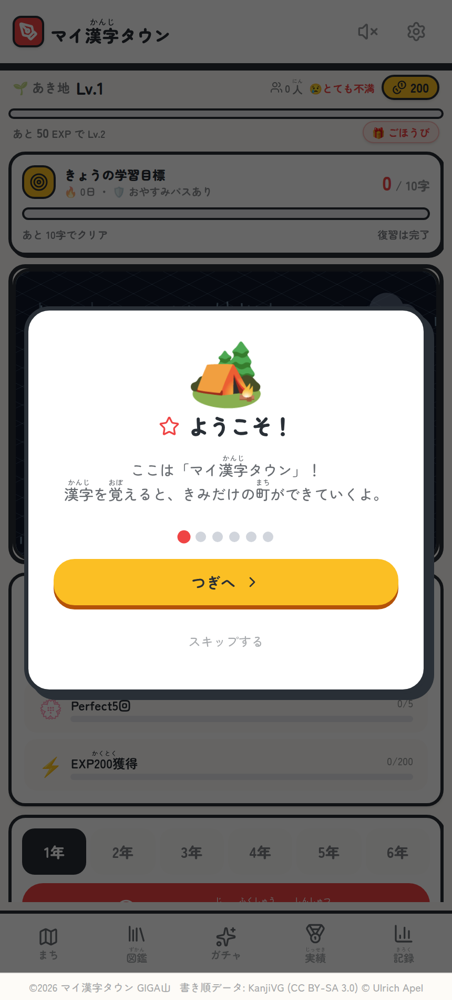

「スキップする」は 左下に あります。

### 学年を えらぶ

あんないが おわると、ホームの<ruby>画面<rt>がめん</rt></ruby>が 出ます。
まん中より 少し下に「1年」から「6年」の ボタンが ならんでいます。

えらびかた:

1. じぶんの <ruby>学年<rt>がくねん</rt></ruby>の ボタンを おします。
2. えらんだ <ruby>学年<rt>がくねん</rt></ruby>は すぐに ほぞんされます。「けってい」の ボタンは ありません。
3. すぐ下の 赤い 大きなボタンの 字数が、えらんだ <ruby>学年<rt>がくねん</rt></ruby>の ものに かわります。

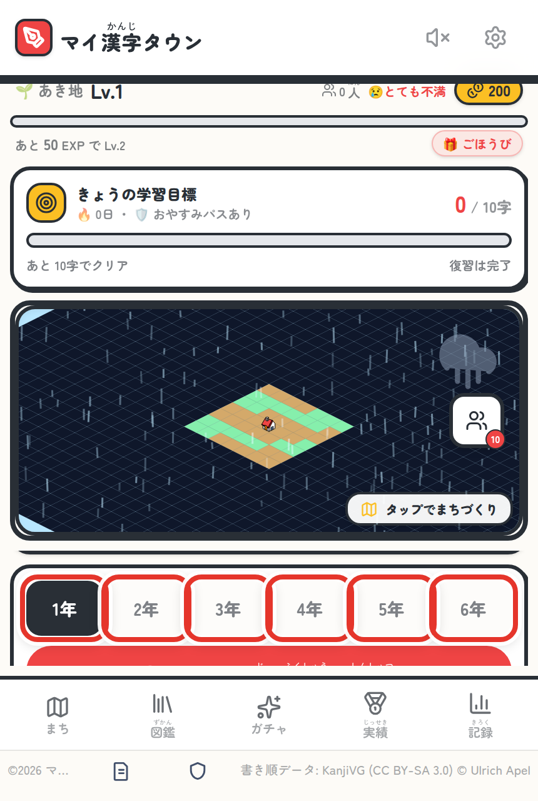

赤いわくの 6つが がくねんの ボタンです。

【！】おぼえておいて ほしいこと:

- <ruby>学年<rt>がくねん</rt></ruby>は いつでも かえられます。ホームの 同じ ボタンを おすだけです
- 上の<ruby>学年<rt>がくねん</rt></ruby>に かえても、下の<ruby>学年<rt>がくねん</rt></ruby>で おぼえた字は きえません
- ならっていない字が むずかしいと かんじたら、下の<ruby>学年<rt>がくねん</rt></ruby>に もどして ください

## ホームの 見かた ― どこに なにが あるか

ホームの<ruby>画面<rt>がめん</rt></ruby>には、上から じゅんに つぎの ものが ならんでいます。
どこに なにが あるかを、さきに 見ておくと まよいません。

上のほうには、じぶんの レベル（Lv.）、まちの 人の数、まちの きぶん、
もっている コインの数が 出ています。その下の <ruby>細<rt>ほそ</rt></ruby>いバーは、
つぎの レベルまで あと どれくらいかを あらわします。
バーの 下には、つぎの レベルで もらえる ごほうびも 出ます。

つぎの 白いカードが「きょうの<ruby>学習目標<rt>がくしゅうもくひょう</rt></ruby>」です。
きょう なん字 やったか、なん日 つづいているか、つぎの <ruby>復習<rt>ふくしゅう</rt></ruby>が
なん字 あるかが 出ます。

まん中の 大きな 絵が、じぶんの まちです。ここを おすと まちづくりの<ruby>画面<rt>がめん</rt></ruby>に
すすみます。
その下に「<ruby>今日<rt>きょう</rt></ruby>のミッション」が あり、きょうの もくひょうと
ごほうびが 出ます。

<ruby>学年<rt>がくねん</rt></ruby>の ボタンの すぐ下に ある 赤い 大きなボタンが、
きょうの<ruby>学習<rt>がくしゅう</rt></ruby>の 入口です。
<ruby>先生<rt>せんせい</rt></ruby>から しゅくだいを もらっているときは、その下に「しゅくだい」が 出ます。
その下に「マイドリル」と「<ruby>通信<rt>つうしん</rt></ruby>でもらう」、さらに下に
とくべつトレーニングの「フラッシュ」「サバイバル」「ボスバトル」が ならびます。

<ruby>画面<rt>がめん</rt></ruby>の いちばん下には、いつも 5つの ボタンが 出ています。
「まち」「<ruby>図鑑<rt>ずかん</rt></ruby>」「ガチャ」「<ruby>実績<rt>じっせき</rt></ruby>」
「<ruby>記録<rt>きろく</rt></ruby>」です。
どの<ruby>画面<rt>がめん</rt></ruby>からでも、ここから 行けます。

赤いわくが、よく つかう ボタンです。

## きょうの<ruby>学習<rt>がくしゅう</rt></ruby>を 4つの ステップで すすめる

まいにちの <ruby>学習<rt>がくしゅう</rt></ruby>は、赤い 大きなボタンから はじめます。
1字ごとに「<ruby>音読<rt>おんどく</rt></ruby> →
<ruby>書<rt>か</rt></ruby>き<ruby>順<rt>じゅん</rt></ruby> → なぞる → テスト」の
4つを じゅんに すすみます。

大きな ながれ:

1. 赤い 大きなボタンを おして、きょうの <ruby>学習<rt>がくしゅう</rt></ruby>を はじめる。
2. <ruby>音読<rt>おんどく</rt></ruby> ― <ruby>声<rt>こえ</rt></ruby>に出して 読む。
3. <ruby>書<rt>か</rt></ruby>き<ruby>順<rt>じゅん</rt></ruby> ― 書く じゅんばんを 見る。
4. なぞる ― うすい お手本を なぞる。
5. テスト ― なにも 見ないで 書く。
6. 「こたえあわせ」を おす。コンピューターが <ruby>点数<rt>てんすう</rt></ruby>を つける。
7. 書けていたら「つぎへ」で つぎの字へ。ちがっていたら もう1回 書く。

### 大きな赤いボタンから はじめる

ボタンには、きょう 出る 字数が 書いてあります。
たとえば「きょうの10字：<ruby>復習<rt>ふくしゅう</rt></ruby>10＋<ruby>新出<rt>しんしゅつ</rt></ruby>0」なら、
きょうは <ruby>復習<rt>ふくしゅう</rt></ruby>が 10字で、はじめての字は 0字、という いみです。

字数は 日によって かわります。<ruby>復習<rt>ふくしゅう</rt></ruby>の ひつような字が
たまっていると ふえます。

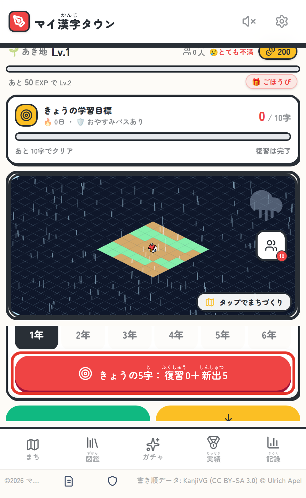

赤いわくの ボタンから はじめます。

### <ruby>音読<rt>おんどく</rt></ruby> ― <ruby>声<rt>こえ</rt></ruby>に出して <ruby>読<rt>よ</rt></ruby>む

さいしょの<ruby>画面<rt>がめん</rt></ruby>には、大きな 字と、その字を つかった 文が 出ます。
下には <ruby>音読<rt>おんよ</rt></ruby>み（オン）と <ruby>訓読<rt>くんよ</rt></ruby>み（くん）が
ならんでいます。

すすめかた:

1. 出ている 字と 文を、<ruby>声<rt>こえ</rt></ruby>に出して 読みます。
2. 文が いくつか あるときは、右の <ruby>丸<rt>まる</rt></ruby>い やじるしで つぎの文に かわります。
3. 読めたら、下の「<ruby>書<rt>か</rt></ruby>き<ruby>順<rt>じゅん</rt></ruby>をみる」を おします。

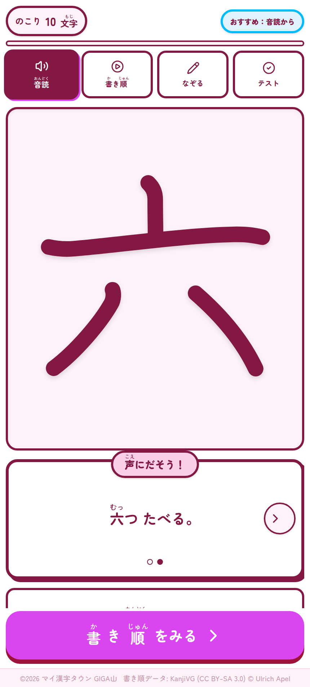

下の 赤い ボタンで つぎへ すすみます。

はじめて この<ruby>画面<rt>がめん</rt></ruby>に 来たときだけ、上に 水色の ふきだしが 出ます。
マイクを つかう「<ruby>音読<rt>おんどく</rt></ruby>チャレンジ」の あんないです。
「×」で とじられます。とじても、あとで もう一度 出ることは ありません。

<ruby>音読<rt>おんどく</rt></ruby>チャレンジは やらなくても かまいません。
できると ボーナスの EXP（けいけんち）が もらえますが、
やらなくても つぎの ステップに すすめます。<ruby>声<rt>こえ</rt></ruby>は ろくおんされません。

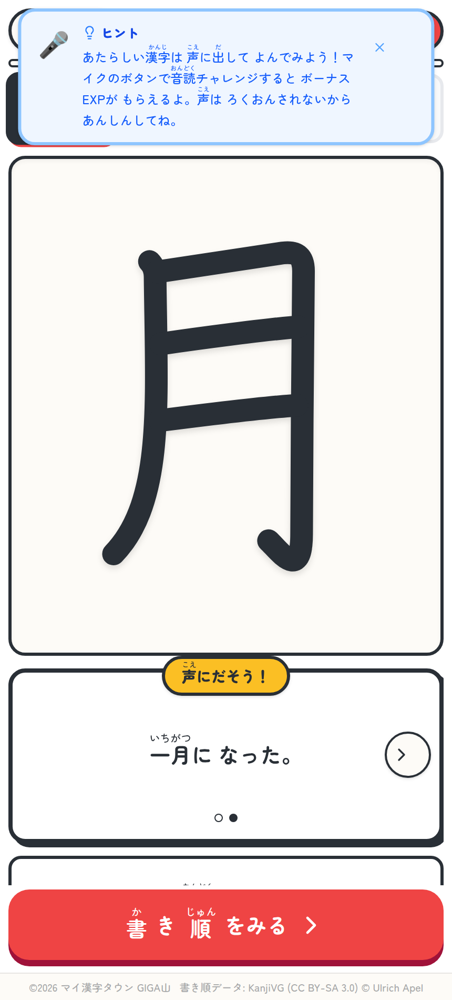

マイクの ボタンは この ふきだしの 下に あります。

### <ruby>書<rt>か</rt></ruby>き<ruby>順<rt>じゅん</rt></ruby> ― <ruby>書<rt>か</rt></ruby>く じゅんばんを 見る

うすい お手本の上を、<ruby>線<rt>せん</rt></ruby>が 1<ruby>画<rt>かく</rt></ruby>ずつ うごきます。
どの じゅんばんで 書くのかを、ここで 見ます。

- もう一度 見たいときは「もう一度みる」を おします。
- 見おわったら「なぞり<ruby>書<rt>が</rt></ruby>きへ」を おします。

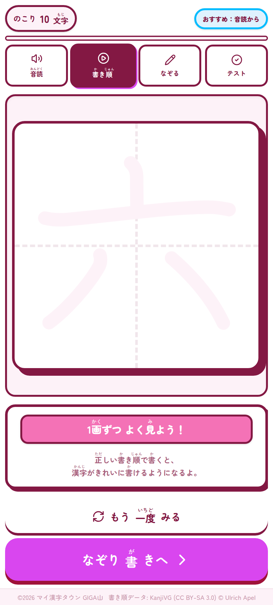

1 2 3 4 の 数字が かくの じゅんばんです。

### なぞる ― うすい お手本を なぞる

うすく 出ている お手本の上を、ゆびか ペンで なぞります。
1<ruby>画<rt>かく</rt></ruby>ずつ 見ていて、書きはじめの ばしょが ちがうと
「かきはじめが ちがうよ」と 出ます。

なぞりかた:

1. 「１かくめ をかこう！」と 出たら、1<ruby>画<rt>かく</rt></ruby>めを なぞります。
2. なぞれたら、つぎの<ruby>画<rt>かく</rt></ruby>へ すすみます。
3. まちがえたときは「1<ruby>画<rt>かく</rt></ruby>もどす」で 1つ もどせます。
4. さいしょから やりなおすときは「ぜんぶけす」を おします。

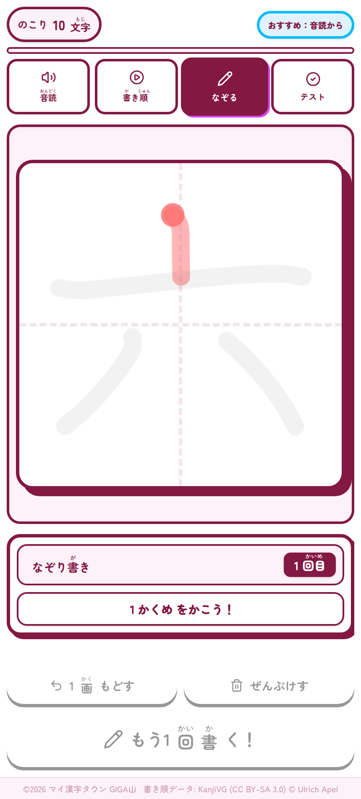

下に 3つの ボタンが あります。

なぞりは 3回 くりかえします。1回ごとに お手本が うすく なっていき、
3回目には ほとんど 見えなく なります。少しずつ じぶんの力で 書けるように なります。

同じ字を もう一度 なぞりたいときは「もう1回書く！」を おします。
つぎへ すすむときは、上の「テスト」の タブを おします。

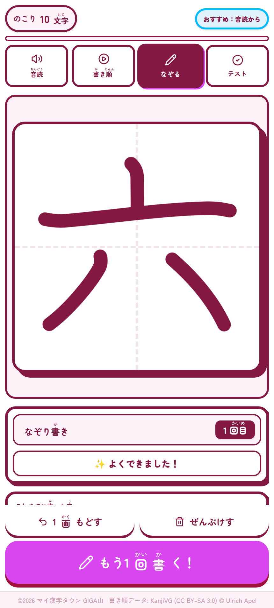

なぞった せんが こく のこります。

### テスト ― なにも 見ないで <ruby>書<rt>か</rt></ruby>く

さいごは、お手本を 見ないで 書きます。
「◯」の 入った 文が 出るので、◯に 入る字を まっ白な ますに 書いてください。
◯の 上の 小さな 字が、その字の 読みかたです。

かきかた:

1. 文を 読んで、◯に 入る字を かんがえます。
2. ますの 中に、ゆびか ペンで 書きます。
3. 1<ruby>画<rt>かく</rt></ruby> まちがえたときは「1<ruby>画<rt>かく</rt></ruby>もどす」を おします。
4. ぜんぶ 書きなおすときは「書きなおす」を おします。
5. 書けたら「こたえあわせ」を おします。

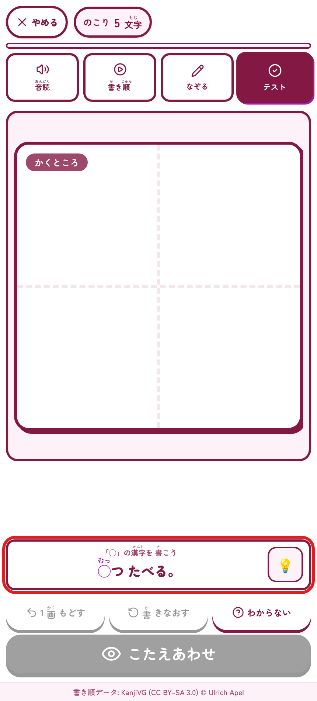

赤いわくの 文の ◯に 入る字を 書きます。

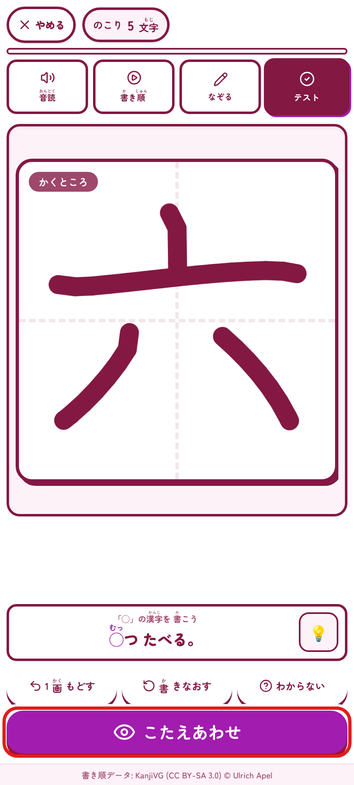

書きおわると「こたえあわせ」が おせます。

どうしても 思い出せないときは、「わからない」を おします。
こたえが 出るので、よく 見てから もう1回 書きます。
「わからない」を おしても、もらえる EXP は へりません。

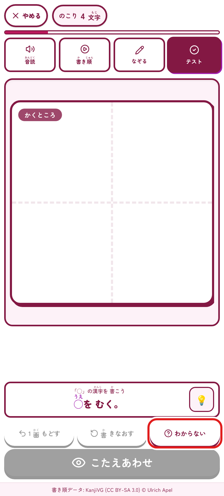

赤いわくが「わからない」の ボタンです。

【！】おぼえておいて ほしいこと:

- とちゅうで タブが とじても、つぎに ひらいたとき つづきから はじまります
- 上の 4つの タブ（<ruby>音読<rt>おんどく</rt></ruby>・<ruby>書<rt>か</rt></ruby>き<ruby>順<rt>じゅん</rt></ruby>・なぞる・テスト）は、「こたえあわせ」を おす前なら 行き来できます
- すでに <ruby>練習<rt>れんしゅう</rt></ruby>した字は、4つ ぜんぶを 通らずに、にがてな ところから はじまります
- 文の 右の 電球の ボタンを おすと、読みかたの ヒントが 出ます

## <ruby>書<rt>か</rt></ruby>いた字の <ruby>点数<rt>てんすう</rt></ruby>の 見かた

書いた字は、コンピューターが 100<ruby>点<rt>てん</rt></ruby>まんてんで <ruby>点数<rt>てんすう</rt></ruby>を つけます。
じぶんで できを えらぶ ボタンは ありません。書いた字で きまります。

### こたえあわせの けっかを 見て、つぎへ すすむ

<ruby>画面<rt>がめん</rt></ruby>には 2つの ますが ならびます。
左の「かくところ」が じぶんの 書いた字、右の「こたえ」が お手本です。

その下の <ruby>帯<rt>おび</rt></ruby>に、ひとことで けっかと <ruby>点数<rt>てんすう</rt></ruby>が 出ます。
<ruby>帯<rt>おび</rt></ruby>の 下には、どの<ruby>画<rt>かく</rt></ruby>に 気をつけるかも 出ます。

- 「よく書けているよ！」80<ruby>点<rt>てん</rt></ruby>より 上です
- 「書けたね！」55<ruby>点<rt>てん</rt></ruby>より 上です
- 「もうすこし ていねいに 書こう」40<ruby>点<rt>てん</rt></ruby>より 上です。ほかの字より 早く また 出ます
- 「せんの まじわりが ちがうよ」「かきじゅんを たしかめよう」つぎへ すすめますが、ほかの字より 早く また 出ます

つぎに いつ 出るかは、「つぎへ」の ボタンに 出ます。よく 書けているほど、あとに なります。

<ruby>点数<rt>てんすう</rt></ruby>は、字の かたち・<ruby>書<rt>か</rt></ruby>き<ruby>順<rt>じゅん</rt></ruby>・
とめはね・<ruby>線<rt>せん</rt></ruby>の まじわり・書きはじめ・書きおわりの
6つを 見て つけます。<ruby>書<rt>か</rt></ruby>き<ruby>順<rt>じゅん</rt></ruby>を まちがえると、
見た目が よくても 高い<ruby>点<rt>てん</rt></ruby>には なりません。

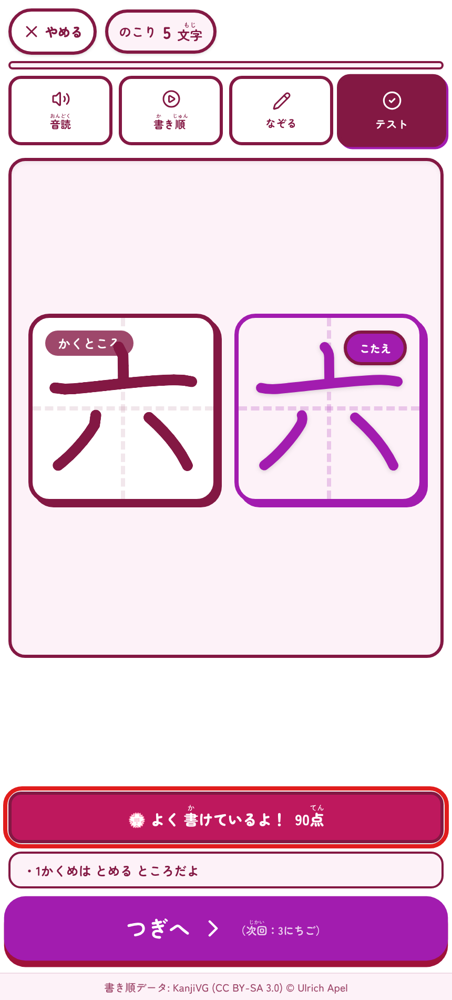

赤いわくに、けっかと 点数が 出ます。

書けていたら、下に「つぎへ」の ボタンが 出ます。おすと つぎの字へ すすみます。

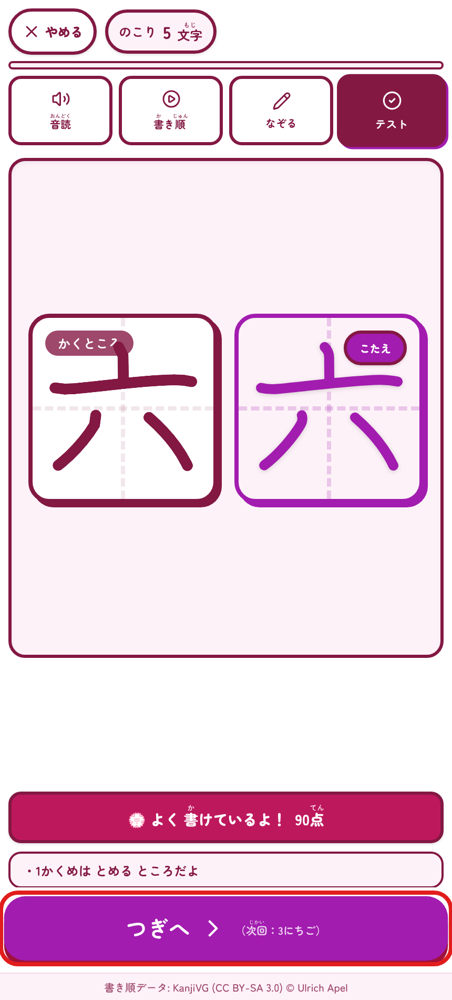

赤いわくの「つぎへ」を おします。

<ruby>画<rt>かく</rt></ruby>の 数が ちがうときや、かたちが ちがうときは、「つぎへ」は 出ません。
かわりに「お手本を 見て もう1回」が 出ます。
おすと、その字が あとで もう一度 出ます。お手本を なぞってから、もう1回 テストを します。

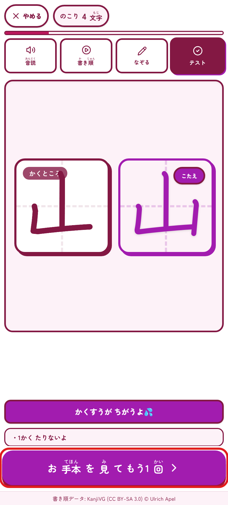

何が ちがったかが 出ます。赤いわくで やりなおします。

【！】おぼえておいて ほしいこと:

- 字が 小さすぎるときも「もう1回」に なります。ますいっぱいに 大きく 書いてください
- 1つの<ruby>画<rt>かく</rt></ruby>は、ゆびを はなさずに さいごまで 書きます。とちゅうで はなすと <ruby>画<rt>かく</rt></ruby>の 数が ふえて、「かくすうが ちがうよ」と 出ます
- ちゃんと 書いたのに「もう1回」に なったときは、もう一度 書いてください。同じ字の 2回目からは、<ruby>画<rt>かく</rt></ruby>が 1つ 多いくらいの ちがいなら つぎへ すすめます
- 同じ字を 3回 やりなおしても できないときは、その字は つぎの <ruby>学習<rt>がくしゅう</rt></ruby>に まわります。また 出てくるので、しんぱい いりません
- 「こたえあわせ」を おしたあとは、ボタンを おすまで ほかの タブへ 行けません

### ほとんど <ruby>書<rt>か</rt></ruby>かずに「こたえあわせ」を おすと、だいじな ものが なくなる

<ruby>線<rt>せん</rt></ruby>を 1本 ひくだけ、<ruby>点<rt>てん</rt></ruby>を うつだけで「こたえあわせ」を おすと、
こたえは 出ずに、たしかめの<ruby>画面<rt>がめん</rt></ruby>が 出ます。

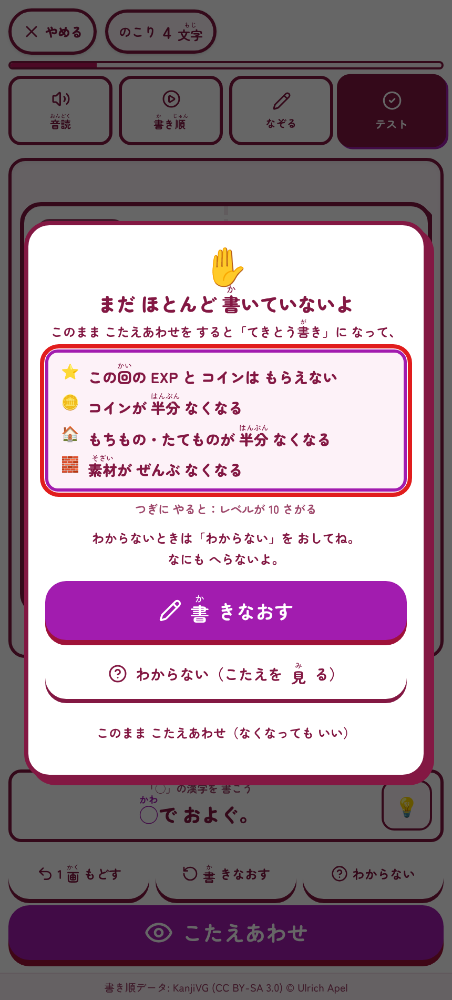

赤いわくに、このまま すすむと なくなる ものが 出ます。

えらべるのは 3つです。

1. 「書きなおす」… もどって 書きます。なにも へりません
2. 「わからない（こたえを 見る）」… こたえを 見て、もう1回 書きます。なにも へりません
3. 「このまま こたえあわせ」… 3びょう まつと おせます。おすと、下の ものが なくなります

「このまま こたえあわせ」を おすと なくなる もの:

- その回に もらえる EXP と コインの ぜんぶ
- 1回目：コインの 半分、もちものの 半分（まちに おいた <ruby>建物<rt>たてもの</rt></ruby>も）、そざいの ぜんぶ
- 2回目：それに くわえて、レベルが 10 さがります
- 3回目から：それに くわえて、まちの 土地が 5マス かれます。かれた 土地には、もう なにも おけません

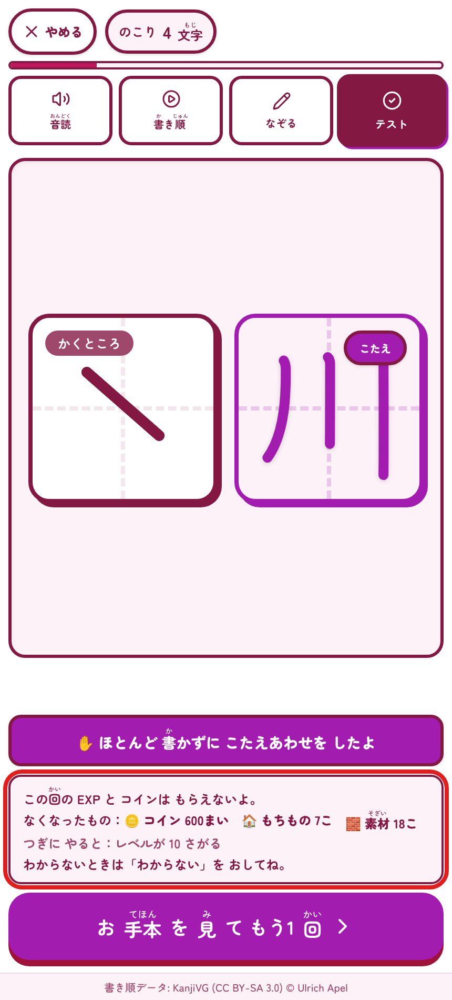

赤いわくに、なくなった ものが 出ます。その字は もう1回に なります。

【！】おぼえておいて ほしいこと:

- まちがえた字は、もう1回 書けば だいじょうぶです。なくなるのは、ほとんど 書かずに「このまま こたえあわせ」を えらんだ ときだけです
- コインや もちものが なくなるのは、1日に 1回までです。同じ日の 2回目からは、その回の EXP と コインが もらえないだけです
- わからないときは「わからない」を おしてください

<ruby>先生<rt>せんせい</rt></ruby>・おうちの<ruby>方<rt>かた</rt></ruby>へ（ここから この節の おわりまでは 大人向けです）:

- たしかめの画面が出るのは、「ほとんど書いていない」答えだけです。書いた線の長さがお手本の1割に満たない（点を打っただけ）か、3画以上の字で、書いた画がお手本の3分の1以下で、お手本の線の半分も書けていないときです
- 画数が1つ多い・書き順がちがう・ほかの字とまちがえた・続けて書いた・タッチがとぎれて線が切れた、のような「書こうとした」答えには出ません。やり直しになるだけで、何も減りません
- 思い出せずに1画だけ書いて手が止まった子にも、たしかめの画面は出ます。「わからない」を選べば何も減りません
- ペナルティは、たしかめの画面で子どもが自分で「このまま こたえあわせ」を選んだときにだけかかります
- 記録は「学習きろく」に出ます。たしかめが出た回数・そのまま進んだ回数（きょうと7日間）・これまでのペナルティの回数・失ったものです。何も無いあいだは出ません
- まちがってペナルティがついたとき（ほかの子がさわった、など）は、「学習きろく」の「さいごの ペナルティを 元に もどす（先生向け）」で戻せます。かけ算の答えを入れると、いちばん新しい1件のコイン・もちもの・素材・レベル・土地が戻ります。戻した日は記録に残ります
- 1字も書けなかった学習は、学習の回数・連続日数・「セッション」のミッションに数えません。レアアイテムも出ません
- 宿題の練習は、3回やり直してもできずに次へ回った字があるあいだは「できた」になりません

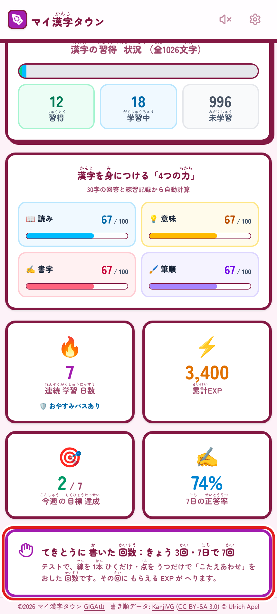

赤いわくに、回数と、失ったもの、元に戻すボタンが出ます。

### さいごに もらえる ごほうびと レベルを たしかめる

その日の 字を ぜんぶ おえると、まとめの<ruby>画面<rt>がめん</rt></ruby>に なります。
もらった EXP と、まちで つかえる ざいりょうが 出ます。

ここから「まちにもどる」で ホームへ、「まちをつくる」で まちづくりへ すすめます。
コインが たまっていれば、そのまま ガチャを ひくことも できます。

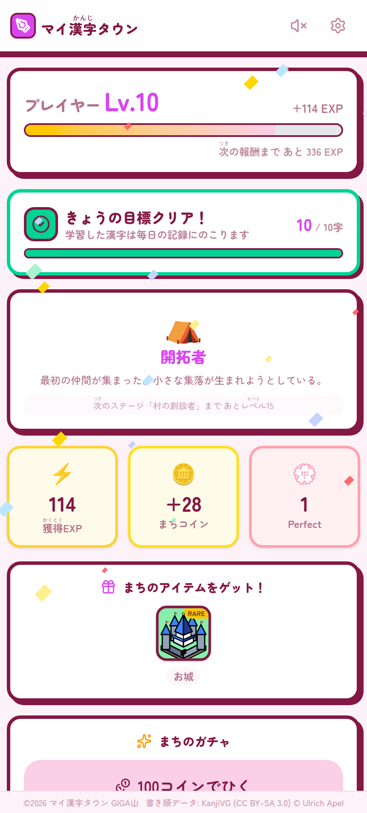

もらった EXP が 上に 出ます。

1字も 書けなかった回は、<ruby>学習<rt>がくしゅう</rt></ruby>の 回数や、つづけた 日数に 入りません。
ほとんど 書かずに「このまま こたえあわせ」を えらんだ回は、なくなった ものも ここに 出ます。

EXP が たまると レベルが 上がります。レベルは 100 で 止まらず、999 まで あります。
レベルが 上がるたびに、コインや まちの たてものが もらえます。

- レベル100 までは、まちが 広がったり、<ruby>画面<rt>がめん</rt></ruby>の 色が かわったり します
- レベル100 から 先は、5レベルごとに めずらしい たてもの、10レベルごとに たくさんの コインが もらえます
- レベル150・200・300・500・999 で、あたらしい よび名（<ruby>名君<rt>めいくん</rt></ruby>・<ruby>大王<rt>だいおう</rt></ruby> など）に なります

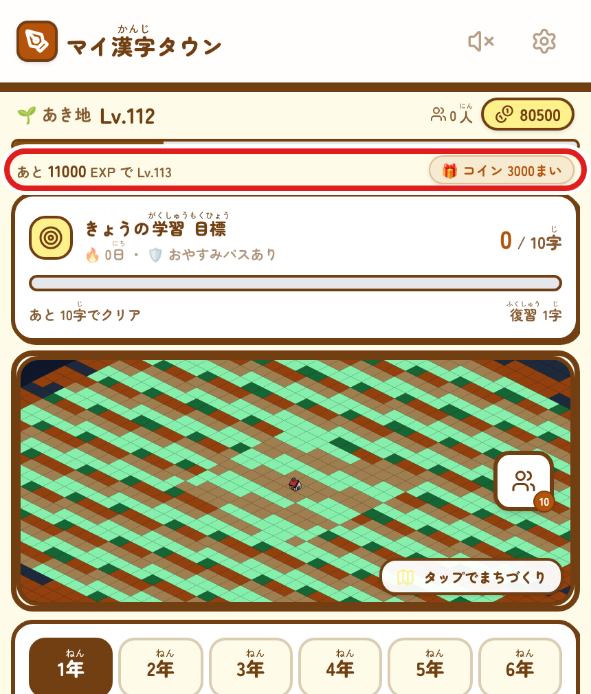

赤いわくに、つぎの レベルまでの EXP と ごほうびが 出ます。

前から つかっていて レベル100 で 止まっていた人は、ひらいたときに
ためていた EXP の 分だけ いっきに レベルが 上がります。ごほうびも まとめて もらえます。

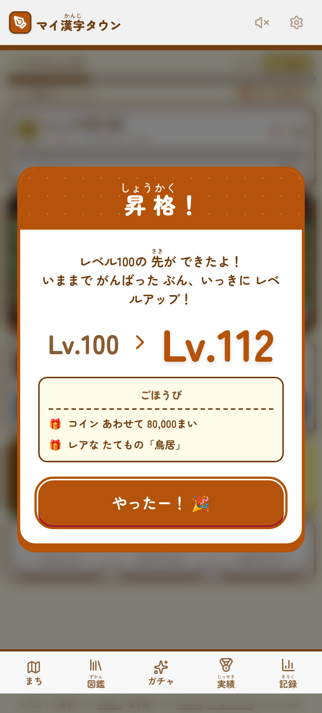

「やったー！」を おすと とじます。

## とくべつトレーニングで まとめて <ruby>復習<rt>ふくしゅう</rt></ruby>する

1字でも おぼえると、ホームの 下のほうに 3つの ボタンが 出ます。
おぼえた字を まとめて 見なおしたいときに つかいます。

まだ 1字も おぼえていないと、3つは 白い カバーが かかっていて おせません。
「まずは漢字を覚えよう！」と 出ているときは、さきに きょうの<ruby>学習<rt>がくしゅう</rt></ruby>を
してください。

### フラッシュ ― <ruby>読<rt>よ</rt></ruby>みだけを 早く 見なおす

おぼえた字から 10字が ランダムに 出ます。カードを タップすると 読みが 出ます。
「読めた」か「読めなかった」を えらんで、つぎへ すすみます。

書く ひつようは ありません。読みだけを 早く たしかめたいときに つかいます。

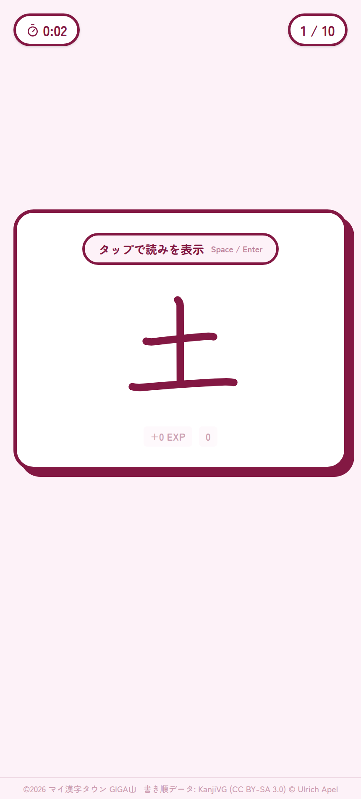

カードを タップすると 読みが 出ます。

### サバイバル ― <ruby>時間<rt>じかん</rt></ruby>の中で <ruby>書<rt>か</rt></ruby>きつづける

<ruby>時間<rt>じかん</rt></ruby>が ある かぎり、おぼえた字を 書きつづけます。
「この「◯」は<ruby>何<rt>なん</rt></ruby>の<ruby>漢字<rt>かんじ</rt></ruby>？」と 文が 出るので、
◯に 入る字を 書きます。

- 書けたら「GO!」を おします。書きなおすときは「消す」です
- <ruby>正解<rt>せいかい</rt></ruby>が つづくと コンボが たまり、<ruby>点<rt>てん</rt></ruby>が 高く なります
- 10<ruby>問<rt>もん</rt></ruby>ごとに ウェーブが 上がります

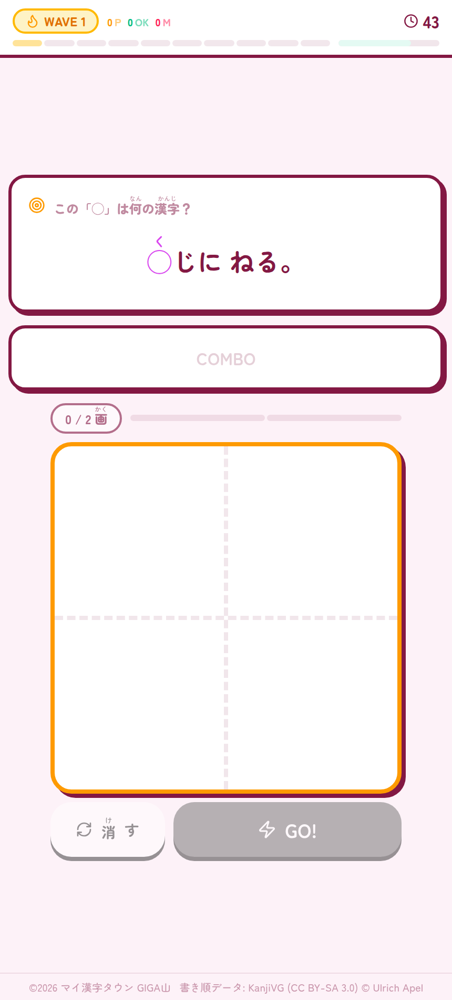

上に のこりじかんと てんすうが 出ます。

### ボスバトル ― にがてな字だけで たたかう

まちがえることの 多い字が 出ます。書いた字で ボスを こうげきします。

1. はじめに、たたかう ボスを えらんで「たたかう！」を おします。
   ボスは 4たい います。前の ボスを たおすと、<ruby>次<rt>つぎ</rt></ruby>の ボスと たたかえます
2. <ruby>文<rt>ぶん</rt></ruby>の「◯」に 入る 字を 書いて「攻撃する！」を おします。書きなおすときは「書き直す」です
3. ていねいに 書けると「かいしんの いちげき」で、大きな ダメージに なります。
   つづけて あてると「コンボ」で、もっと 大きく なります

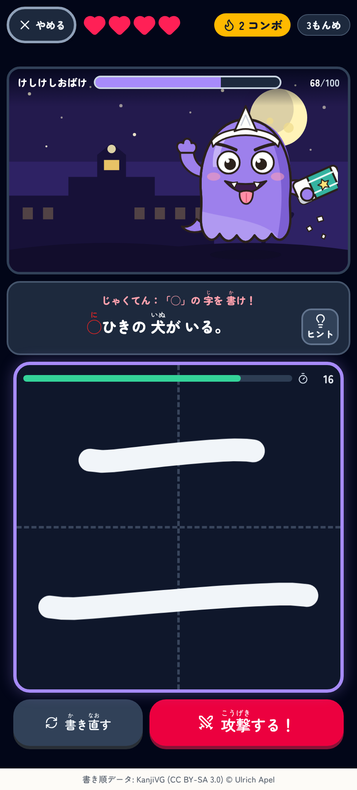

上に じぶんの ハートが、ボスの 上に ボスの たいりょくが 出ます。

- 書けなかったときは、ボスが こうげきして ハートが 1つ へります。ハートが なくなると まけです
- 書きじゅんが ちがうときや、1かく 多い・少ないときは、ボスに「ふせがれる」だけで ハートは へりません
- まちがえたあとは「こたえ」が 出ます。よく <ruby>見<rt>み</rt></ruby>てから「つぎへ」を おします
- まちがえた字は、すこし あとで「リベンジ」として もう1<ruby>回<rt>かい</rt></ruby> 出ます。
  書けたら ダメージが ふえて、ハートが 1つ もどります
- じかんが なくなると、書いた ところまでで こうげきします
- ヒントの ボタンを おすと、<ruby>読<rt>よ</rt></ruby>みかたが 出ます

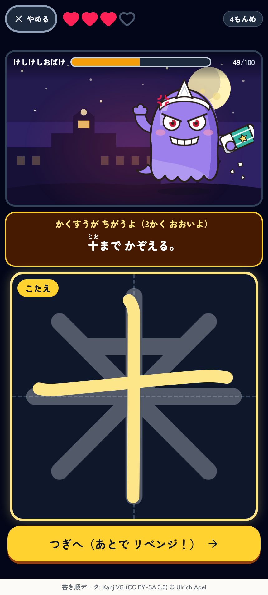

かつと ほしが もらえます。ハートを 1つも へらさずに かつと、ほしが 3つです。

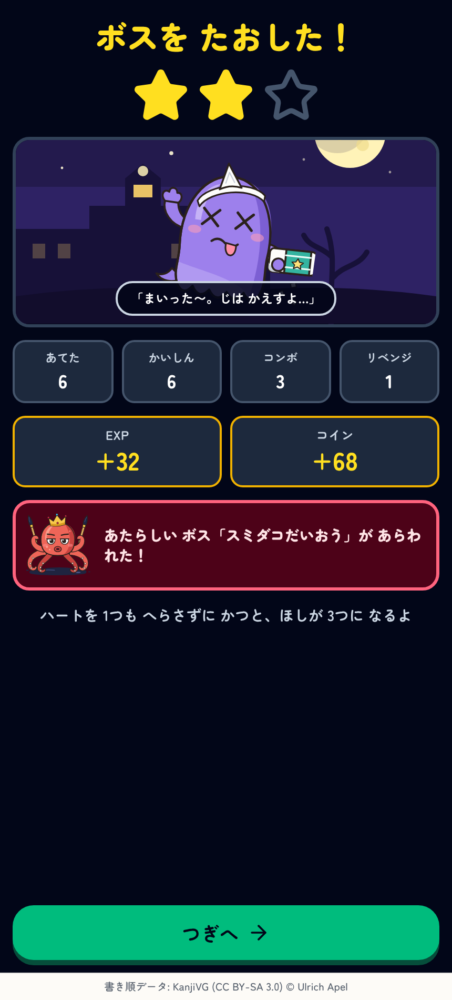

まけても だいじょうぶです。ごほうびは <ruby>半分<rt>はんぶん</rt></ruby>に なりますが もらえます。
まちがえた字は、そのあと すぐ <ruby>復習<rt>ふくしゅう</rt></ruby>に 出るように なります。

## しゅくだいを する

<ruby>先生<rt>せんせい</rt></ruby>が ドリルを「しゅくだい」として くばると、ホームに「しゅくだい」が 出ます。
しめきりと、やること（れんしゅう か テスト）が きまっています。

### しゅくだいを うけとる

<ruby>先生<rt>せんせい</rt></ruby>から もらった リンクを ひらくと「<ruby>宿題<rt>しゅくだい</rt></ruby>が とどきました」と 出ます。
しめきりと やることを たしかめてください。

1. いますぐ やるときは「<ruby>保存<rt>ほぞん</rt></ruby>して いま やる」を おします。
2. あとで やるときは「<ruby>保存<rt>ほぞん</rt></ruby>して あとで やる」を おします。ホームに もどります。
3. 4けたの すうじで もらったときも、おなじように しめきりと やることが 出ます。

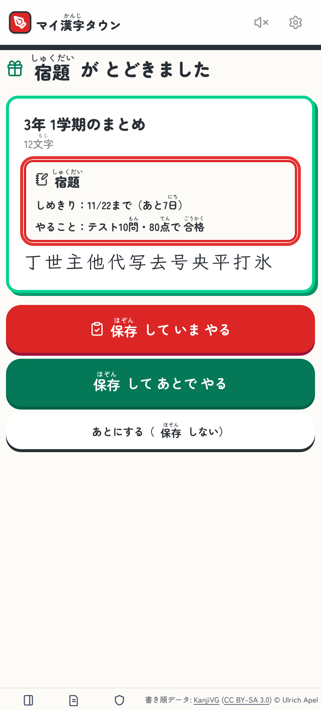

しめきりと やることが 赤い わくの 中に 出ます。

### ホームの「しゅくだい」から はじめる

ホームの 赤い 大きなボタンの 下に「しゅくだい」が 出ます。
しめきりが ちかい じゅんに ならんでいます。おすと、きまった れんしゅうか テストが はじまります。

- 「まだ」まだ やっていない
- 「とりくみ中」やったけれど、テストの <ruby>点<rt>てん</rt></ruby>が まだ ごうかくに とどいていない
- 「できた」おわった。しめきりの 日まで ホームに のこります

スマートフォンでは、まちの 左上に「しゅくだい 1」の ふだが 出ます。
おすと「しゅくだい」の ところまで うごきます。
しめきりを すぎても、いつでも できます。そのまま やってください。

マイドリルの「<ruby>練習<rt>れんしゅう</rt></ruby>」「テスト」から やっても しゅくだいに なります。
テストは、きまった <ruby>問題数<rt>もんだいすう</rt></ruby>より 少ないと しゅくだいに なりません。

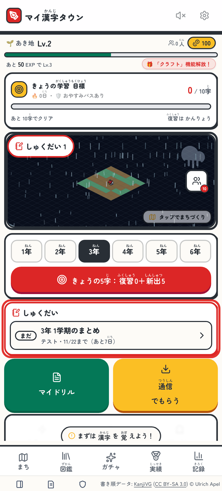

赤い 大きなボタンの 下に 出ます。

### おわったら <ruby>先生<rt>せんせい</rt></ruby>に 見せる

しゅくだいを おえると、まとめの <ruby>画面<rt>がめん</rt></ruby>の いちばん上に「<ruby>宿題<rt>しゅくだい</rt></ruby>」が 出ます。
「<ruby>先生<rt>せんせい</rt></ruby>に<ruby>見<rt>み</rt></ruby>せる」を おすと、ドリルの なまえ・<ruby>点数<rt>てんすう</rt></ruby>・できた日が 大きく 出ます。
そのまま <ruby>先生<rt>せんせい</rt></ruby>に 見せてください。じぶんの なまえは 出ません。

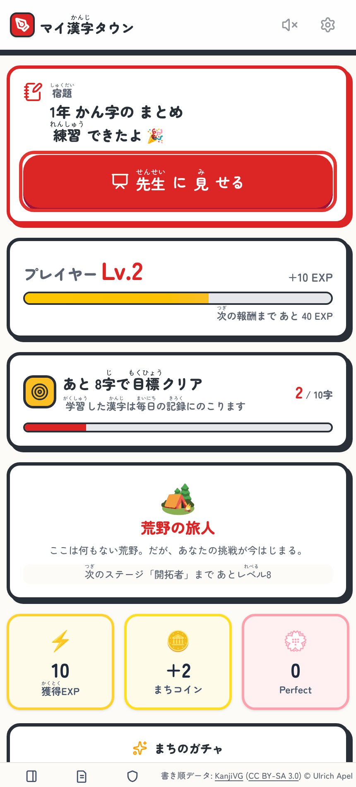

赤い わくの「<ruby>先生<rt>せんせい</rt></ruby>に<ruby>見<rt>み</rt></ruby>せる」を おします。

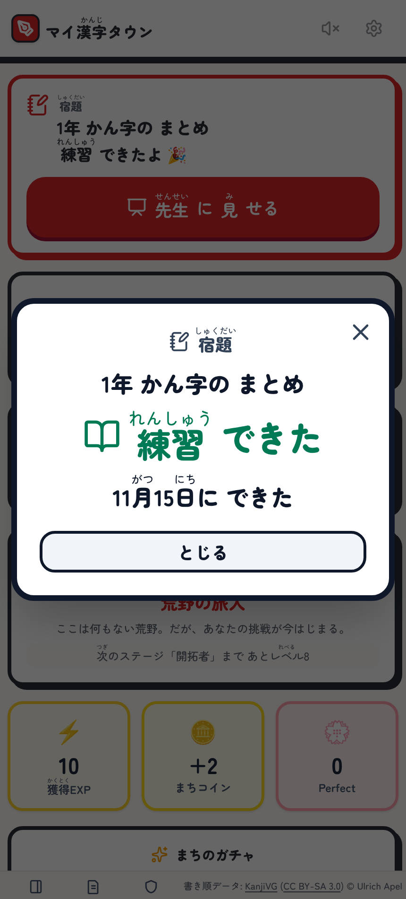

マイドリルにも、しゅくだいの ようすと、いちばん よかった <ruby>点<rt>てん</rt></ruby>、やった <ruby>回数<rt>かいすう</rt></ruby>が 出ます。

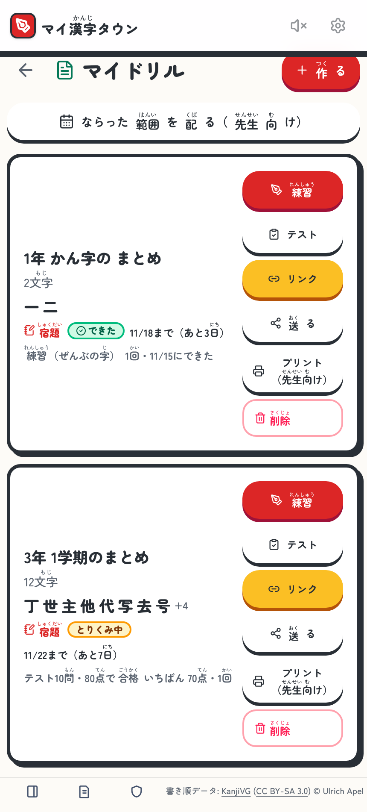

## <ruby>先生<rt>せんせい</rt></ruby>から「ならった はんい」が とどいたら

<ruby>先生<rt>せんせい</rt></ruby>が「ならった<ruby>範囲<rt>はんい</rt></ruby>」を くばると、
まいにちの <ruby>学習<rt>がくしゅう</rt></ruby>で はじめて ならう 字（<ruby>新出<rt>しんしゅつ</rt></ruby>）が、
じゅぎょうで ならった 字だけに なります。<ruby>復習<rt>ふくしゅう</rt></ruby>は いままでどおりです。

1. リンクを ひらくと「ならった<ruby>範囲<rt>はんい</rt></ruby>が とどきました」と 出ます。
2. 「ならった<ruby>範囲<rt>はんい</rt></ruby>として つかう」を おします。
3. まえの はんいが あるときは「おきかえて つかう」と 出ます。おすと 新しい はんいに かわります。

字は、日づけが きた だんから じゅんばんに 出ます。
まだ 日づけの こない だんの 字は、その日に なると 出てきます。

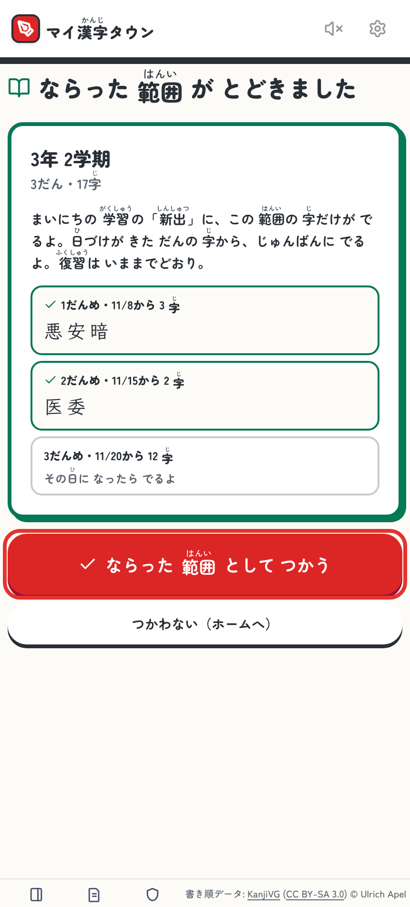

赤い わくの ボタンで つかいはじめます。

ホームの 赤い 大きなボタンの 下に、はんいの なまえと、
つぎの 字が いつから なん字 出るかが 出ます（「11/20から あたらしい字が 12字」など）。
はんいの 字を ぜんぶ ならうと、えらんだ <ruby>学年<rt>がくねん</rt></ruby>の 字が 出るように もどります。

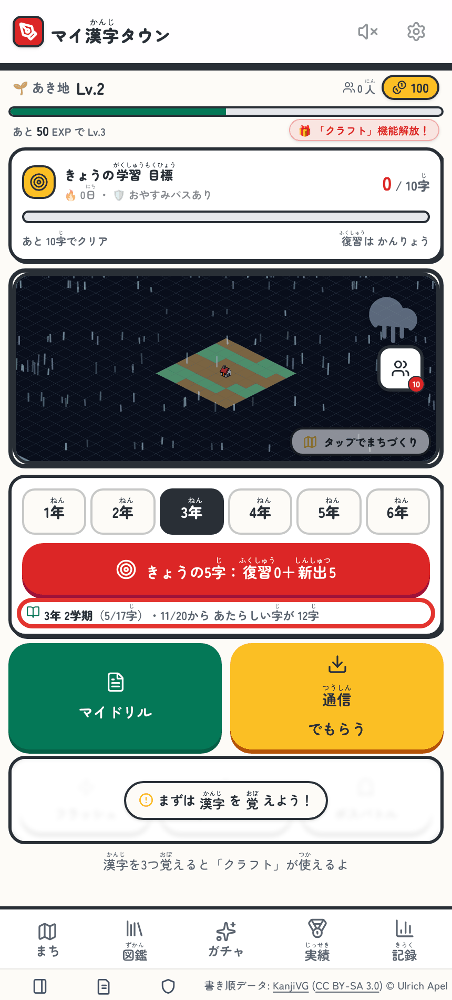

赤い わくの ところに 出ます。

はんいを やめたいときは、せっていの「<ruby>学習<rt>がくしゅう</rt></ruby>せってい」の
いちばん下の「<ruby>範囲<rt>はんい</rt></ruby>を やめる」を おします。
ならった 字の <ruby>記録<rt>きろく</rt></ruby>は きえません。

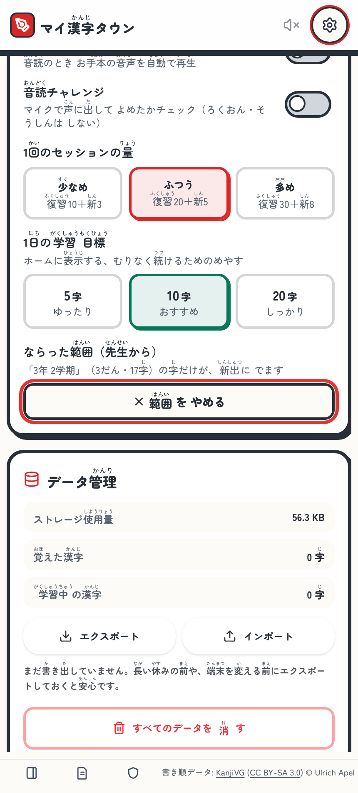

赤い わくの ボタンで やめられます。

## <ruby>学習<rt>がくしゅう</rt></ruby>きろくで <ruby>自分<rt>じぶん</rt></ruby>の のびを 見る

<ruby>画面<rt>がめん</rt></ruby>の いちばん下の「<ruby>記録<rt>きろく</rt></ruby>」から ひらきます。
どれだけ おぼえたか、どの力が よわいかが わかります。

### おぼえた字の <ruby>数<rt>かず</rt></ruby>と 4つの力を たしかめる

いちばん上に「<ruby>漢字<rt>かんじ</rt></ruby>の<ruby>習得状況<rt>しゅうとくじょうきょう</rt></ruby>（全1026文字）」が 出ます。
「<ruby>習得<rt>しゅうとく</rt></ruby>」「<ruby>学習中<rt>がくしゅうちゅう</rt></ruby>」
「<ruby>未学習<rt>みがくしゅう</rt></ruby>」の 3つの数に わかれています。

その下が「<ruby>漢字<rt>かんじ</rt></ruby>を<ruby>身<rt>み</rt></ruby>につける「4つの力」」です。
「<ruby>読<rt>よ</rt></ruby>み」「<ruby>意味<rt>いみ</rt></ruby>」「<ruby>書字<rt>しょじ</rt></ruby>」
「<ruby>筆順<rt>ひつじゅん</rt></ruby>」を それぞれ 100<ruby>点<rt>てん</rt></ruby>まんてんで 出します。

4つを 分けて 出すのは、「読めるけれど 書けない」のような ことを 見わけるためです。
<ruby>点<rt>てん</rt></ruby>の ひくい ところが、いま <ruby>練習<rt>れんしゅう</rt></ruby>すると
いちばん のびる ところです。

さらに 下には、つづけた 日数、これまでの EXP、<ruby>今週<rt>こんしゅう</rt></ruby>の もくひょう、
7日間の <ruby>正解率<rt>せいかいりつ</rt></ruby>が ならびます。
てきとう書きが あったときは、その下に きろくが 出ます。

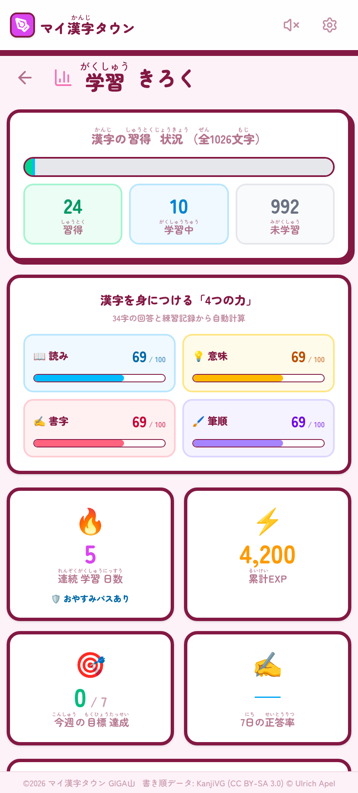

3つの 数と 4つの力が わかります。

### これから 出る字と にがてな字を 見る

下へ すすむと、7日間の <ruby>学習<rt>がくしゅう</rt></ruby>の ぼうグラフ、さいきん やったこと、
これから 7日間に 出る <ruby>復習<rt>ふくしゅう</rt></ruby>の 数、にがてな字が ならびます。

にがてな字の ところに「にがて<ruby>特訓<rt>とっくん</rt></ruby>」の ボタンが あります。
おすと、その字だけを あつめた <ruby>練習<rt>れんしゅう</rt></ruby>が すぐ はじまります。

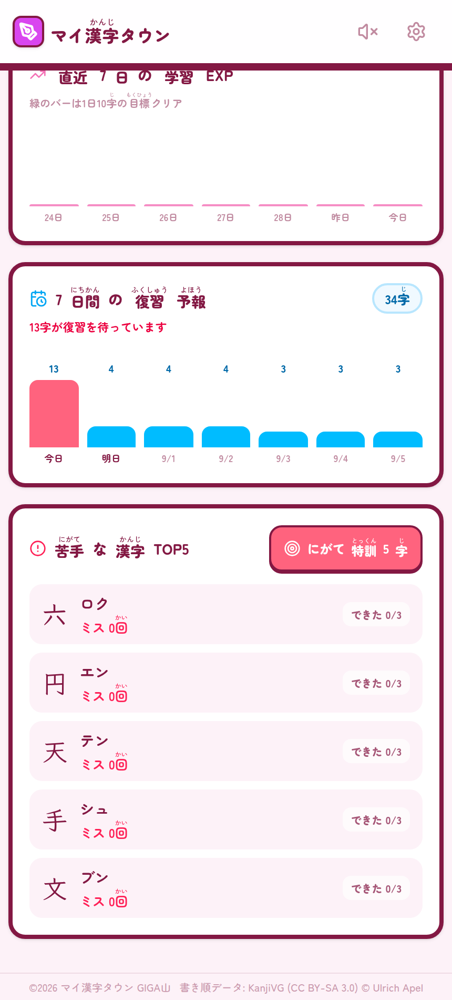

「にがて特訓」から すぐ 練習できます。

### <ruby>学習<rt>がくしゅう</rt></ruby>きろくを A4 で <ruby>印刷<rt>いんさつ</rt></ruby>する

この<ruby>画面<rt>がめん</rt></ruby>は、そのまま <ruby>紙<rt>かみ</rt></ruby>に
<ruby>印刷<rt>いんさつ</rt></ruby>できます。
<ruby>面談<rt>めんだん</rt></ruby>や おたよりに つかうときは、つぎのように してください。

<ruby>印刷<rt>いんさつ</rt></ruby>の手順:

1. キーボードの Ctrl と P を いっしょに おします（Mac は コマンドと P です）。
2. <ruby>用紙<rt>ようし</rt></ruby>が A4、むきが たて に なっているかを たしかめます。
3. 「背景のグラフィック」を オンに します。オフのままだと、<ruby>正解<rt>せいかい</rt></ruby>・まちがいの <ruby>色分<rt>いろわ</rt></ruby>けが 消えます。
4. 「<ruby>印刷<rt>いんさつ</rt></ruby>」を おします。

【！】おぼえておいて ほしいこと:

- <ruby>画面<rt>がめん</rt></ruby>の 上の ナビゲーションと 下の フッターは、<ruby>印刷<rt>いんさつ</rt></ruby>には 出ません
- <ruby>印刷<rt>いんさつ</rt></ruby>した<ruby>紙<rt>かみ</rt></ruby>には <ruby>名前<rt>なまえ</rt></ruby>が 入りません。だれの <ruby>記録<rt>きろく</rt></ruby>かを 手で 書きくわえてください

## <ruby>漢字<rt>かんじ</rt></ruby>ずかんで さがして 1字だけ <ruby>練習<rt>れんしゅう</rt></ruby>する

<ruby>画面<rt>がめん</rt></ruby>の いちばん下の「<ruby>図鑑<rt>ずかん</rt></ruby>」から ひらきます。
1026字ぜんぶを 見られて、気になる 1字だけを <ruby>練習<rt>れんしゅう</rt></ruby>できます。

### 学年や <ruby>読<rt>よ</rt></ruby>みで 字を さがす

上の タブで <ruby>学年<rt>がくねん</rt></ruby>を えらべます。「すべて」と「1年」から「6年」が あります。
タブには、その<ruby>学年<rt>がくねん</rt></ruby>で いくつ おぼえたかが 出ます
（たとえば「1年 34/80」）。

字は 4つの いろで 分かれています。
「<ruby>習得<rt>しゅうとく</rt></ruby>」「<ruby>学習中<rt>がくしゅうちゅう</rt></ruby>」
「<ruby>復習中<rt>ふくしゅうちゅう</rt></ruby>」「<ruby>未学習<rt>みがくしゅう</rt></ruby>」です。
いまの じぶんの ようすが 一目で わかります。

上の さがす らんに <ruby>漢字<rt>かんじ</rt></ruby>や 読みを 入れると、その字だけが のこります。
見つからないときは「見つかりませんでした」と 出ます。

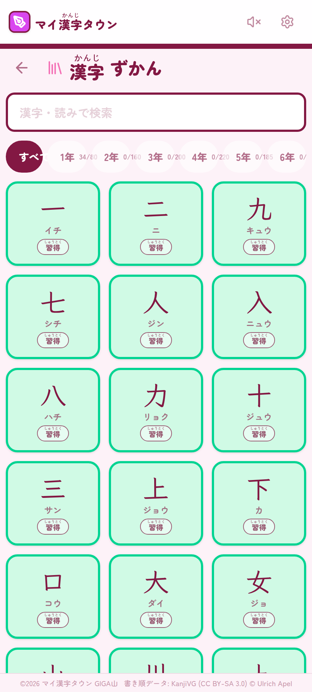

がくねんの タブと 字の 一らんです。

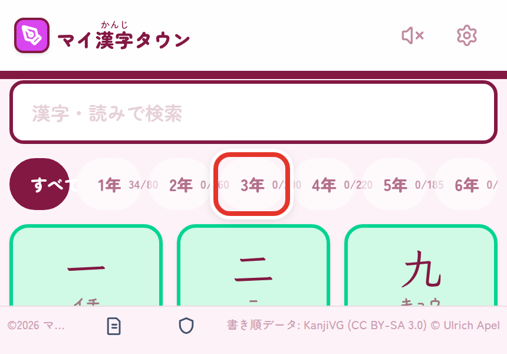

赤いわくの タブで がくねんを かえます。

### 字を えらんで その字だけ <ruby>練習<rt>れんしゅう</rt></ruby>する

<ruby>一覧<rt>いちらん</rt></ruby>の 中の 字を おすと、その 1字だけの
<ruby>練習<rt>れんしゅう</rt></ruby>が はじまります。
きょうの<ruby>学習<rt>がくしゅう</rt></ruby>と 同じ 4つの ステップを 通ります。

<ruby>漢字<rt>かんじ</rt></ruby>テストの 前の日など、「この字だけ もう一度 やりたい」ときに
つかってください。

## <ruby>実績<rt>じっせき</rt></ruby>を あつめて ごほうびを もらう

<ruby>画面<rt>がめん</rt></ruby>の いちばん下の「<ruby>実績<rt>じっせき</rt></ruby>」から ひらきます。
がんばりに あわせて、コインや <ruby>建物<rt>たてもの</rt></ruby>が もらえます。

### 92この <ruby>実績<rt>じっせき</rt></ruby>を 見る

<ruby>実績<rt>じっせき</rt></ruby>は ぜんぶで 92こ あります。
上の タブで 5つの なかまに 分かれています。
「<ruby>学習<rt>がくしゅう</rt></ruby>」「<ruby>学年制覇<rt>がくねんせいは</rt></ruby>」
「まちづくり」「<ruby>毎日<rt>まいにち</rt></ruby>のがんばり」
「<ruby>成長<rt>せいちょう</rt></ruby>の<ruby>記録<rt>きろく</rt></ruby>」です。

それぞれの カードに、いまの 数と めざす 数、もらえる ごほうびが 出ます。
とどいた ものには「受けとる！」の ボタンが 出るので、おして うけとってください。

うけとらないと、ごほうびは もらえません。ときどき 見にきてください。

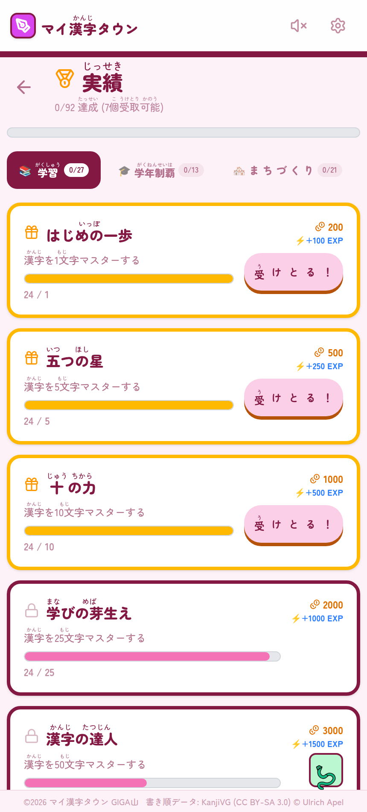

「受けとる！」を おすと もらえます。

### まいにち ひらいて ログインボーナスを もらう

2日目からは、ひらいた ときに ログインボーナスが 出ることが あります。
7日分の ごほうびが ならび、つづけた 日数の ところが もらえます。

「うけとる！」を おすと とじます。おすまで、ほかの ボタンは おせません。

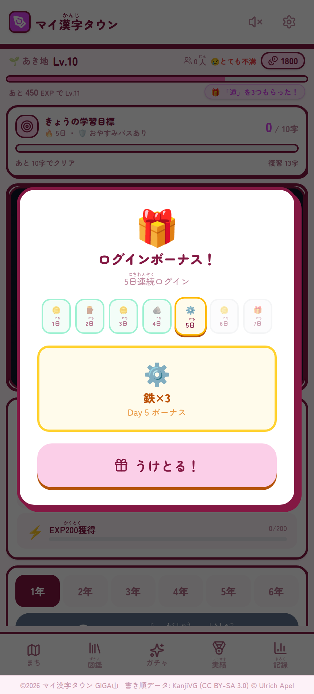

「うけとる！」で とじます。

## まちを そだてる ― <ruby>建物<rt>たてもの</rt></ruby>を <ruby>作<rt>つく</rt></ruby>って ならべる

ホームの まん中の 絵を おすか、いちばん下の「まち」から ひらきます。
<ruby>学習<rt>がくしゅう</rt></ruby>を すすめると、ここに おける ものが ふえていきます。

### <ruby>地面<rt>じめん</rt></ruby>を ひらいて <ruby>建物<rt>たてもの</rt></ruby>を おく

まちは、くもの 上に うかぶ しまです。ぜんぶで 50×50 の ますが あります。
はじめは まん中の 少しだけが 見えていて、レベルが 上がると しまが <ruby>広<rt>ひろ</rt></ruby>がります。

しまには、まだ ひらいていない <ruby>土地<rt>とち</rt></ruby>が あります。
<ruby>草<rt>くさ</rt></ruby>が 生えている ところ、<ruby>岩<rt>いわ</rt></ruby>や かれ<ruby>草<rt>くさ</rt></ruby>の ところ、
<ruby>木<rt>き</rt></ruby>が かたまって 生えている ところが それです。
うすい <ruby>茶色<rt>ちゃいろ</rt></ruby>の ところが、ひらいた <ruby>土地<rt>とち</rt></ruby>です。

- ひらいていない <ruby>土地<rt>とち</rt></ruby>を おすと、コインを つかって ひらけます。<ruby>草地<rt>くさち</rt></ruby>は 10まい、あれ<ruby>地<rt>ち</rt></ruby>は 15まい、<ruby>森<rt>もり</rt></ruby>は 30まいです
- ひらいた <ruby>土地<rt>とち</rt></ruby>に、もちものを おけます
- おす ところの ますが <ruby>色<rt>いろ</rt></ruby>で 光ります。みどりは おける、赤は おけない、です
- おいた ものを おすと、もちあげて べつの ところに おきなおせます
- 大きな <ruby>建物<rt>たてもの</rt></ruby>は、<ruby>足<rt>あし</rt></ruby>もとの どの ますを おしても もちあがります
- <ruby>指<rt>ゆび</rt></ruby> 2本で つまむと、大きく したり 小さく したり できます。右の <ruby>虫<rt>むし</rt></ruby>めがねの ボタンでも できます
- 右上の <ruby>丸<rt>まる</rt></ruby>い やじるしで、ひとつ前に もどせます
- おいた ものは、そのたびに ほぞんされます。右上の「<ruby>保存<rt>ほぞん</rt></ruby>」を おすと ホームに もどります

<ruby>道<rt>みち</rt></ruby>や <ruby>水路<rt>すいろ</rt></ruby>、<ruby>田<rt>た</rt></ruby>んぼは、となりに ならべると つながって 見えます。
<ruby>橋<rt>はし</rt></ruby>を <ruby>水路<rt>すいろ</rt></ruby>の とちゅうに おくと、下を 水が ながれます。<ruby>橋<rt>はし</rt></ruby>は、<ruby>水路<rt>すいろ</rt></ruby>を またぐ むきに かかります。
<ruby>道<rt>みち</rt></ruby>の 上には、<ruby>車<rt>くるま</rt></ruby>や ベンチを のせられます。<ruby>車<rt>くるま</rt></ruby>や バスは、<ruby>道<rt>みち</rt></ruby>の むきに そろいます。
<ruby>夜<rt>よる</rt></ruby>に ひらくと、まちの <ruby>建物<rt>たてもの</rt></ruby>に あかりが つきます。

下に 3つの ボタンが あります。「もちもの」「つくる」「<ruby>住民<rt>じゅうみん</rt></ruby>」です。

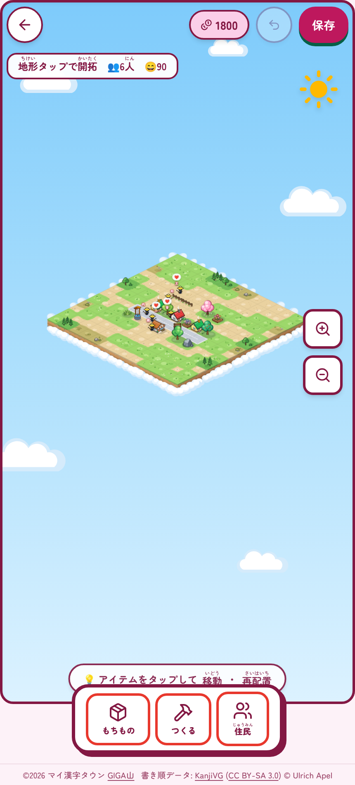

赤いわくの 3つが 下の ボタンです。

### クラフトで <ruby>建物<rt>たてもの</rt></ruby>を <ruby>作<rt>つく</rt></ruby>る

下の「つくる」から ひらきます。<ruby>学習<rt>がくしゅう</rt></ruby>で あつまった
ざいりょうで、<ruby>建物<rt>たてもの</rt></ruby>や 新しい ざいりょうを 作れます。
ぜんぶで 121<ruby>種類<rt>しゅるい</rt></ruby> あります。

上に いま もっている ざいりょうが 出ます。
その下の タブで「<ruby>加工素材<rt>かこうそざい</rt></ruby>」「<ruby>建物<rt>たてもの</rt></ruby>」
「<ruby>強化<rt>きょうか</rt></ruby>」「<ruby>大型<rt>おおがた</rt></ruby>」「かざり」「レア」に 分かれています。
「かざり」では、<ruby>木<rt>き</rt></ruby>や <ruby>花<rt>はな</rt></ruby>、ふんすい、のりもの、ベンチなどを <ruby>作<rt>つく</rt></ruby>れます。
<ruby>道<rt>みち</rt></ruby>や <ruby>田<rt>た</rt></ruby>んぼ、はたけは「<ruby>建物<rt>たてもの</rt></ruby>」に 入っています。

作りかた:

1. 作りたい ものの カードを さがします。
2. 「-」と「+」で 数を きめます。ぜんぶ 作るときは「MAX」を おします。
3. 「クラフトする」を おします。

ざいりょうが たりないときは「<ruby>素材不足<rt>そざいぶそく</rt></ruby>」と 出て、おせません。
<ruby>学習<rt>がくしゅう</rt></ruby>を すすめると ざいりょうが たまります。

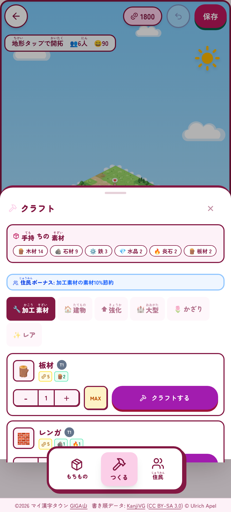

上に もっている ざいりょうが 出ます。

### ガチャで めずらしい <ruby>建物<rt>たてもの</rt></ruby>を ひく

いちばん下の「ガチャ」から ひらきます。コインを つかって
<ruby>建物<rt>たてもの</rt></ruby>を ひきます。

- 「1回」は 100コインです
- 「10<ruby>連<rt>れん</rt></ruby>」は 1000コインです
- ながい えんしゅつは「演出をスキップする」で とばせます

コインは <ruby>学習<rt>がくしゅう</rt></ruby>と <ruby>実績<rt>じっせき</rt></ruby>で たまります。
ひかなくても まちは そだちます。

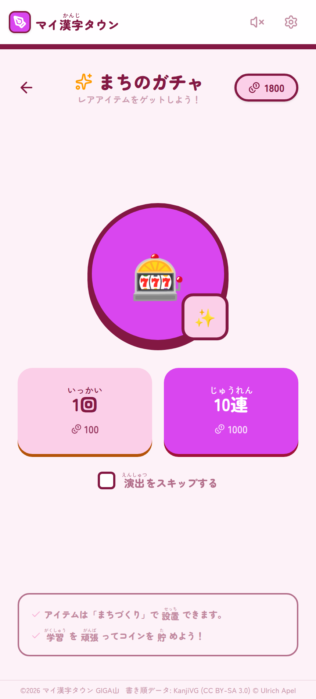

いま もっている コインが 上に 出ます。

### しばらく ひらかないと まちが あれる

ながく ひらかないと、まちは だんだん あれていきます。
1日で くさが はえ、3日で 人が 少し へり、7日で <ruby>建物<rt>たてもの</rt></ruby>が
<ruby>元<rt>もと</rt></ruby>の 土地に もどります。

<ruby>学習<rt>がくしゅう</rt></ruby>を すると、その場で くさは とれます。
1日 やすんでも つづけた 日数を まもる「おやすみパス」も あります。
つかったあとは、5日 <ruby>学習<rt>がくしゅう</rt></ruby>すると また たまります。

はい色で ひびの 入った マスは「かれた土地」です。テストで ほとんど 書かずに
「このまま こたえあわせ」を えらんだ ときの ペナルティで できます。
ここには なにも おけません。<ruby>学習<rt>がくしゅう</rt></ruby>を しても もどりません。

## せっていで 音・文字・<ruby>学習<rt>がくしゅう</rt></ruby>の <ruby>量<rt>りょう</rt></ruby>を かえる

<ruby>画面<rt>がめん</rt></ruby>の 右上の はぐるまの ボタンから ひらきます。
見た目・音・<ruby>学習<rt>がくしゅう</rt></ruby>の 量を かえられます。

### 見た目と 音を かえる

いちばん上が「テーマ」です。7つから えらべます。
「じどう」「ベーシック」「さくら」「うみ」「ゆうやけ」「おうごん」「ダーク」です。
「じどう」は レベルに あわせて 色が かわります。

つぎが「<ruby>画面<rt>がめん</rt></ruby>のうごき」です。「じどう」「<ruby>標準<rt>ひょうじゅん</rt></ruby>」
「少なめ」の 3つです。
「少なめ」に すると、うごきや <ruby>天気<rt>てんき</rt></ruby>や
<ruby>紙<rt>かみ</rt></ruby>ふぶきを おさえます。
うごきが おそい <ruby>端末<rt>たんまつ</rt></ruby>や、<ruby>電池<rt>でんち</rt></ruby>を
もたせたい ときに つかってください。

その下が「<ruby>文字<rt>もじ</rt></ruby>の<ruby>大<rt>おお</rt></ruby>きさ」です。「ふつう」「<ruby>大<rt>おお</rt></ruby>きめ」「とても<ruby>大<rt>おお</rt></ruby>きい」の 3つです。
<ruby>画面<rt>がめん</rt></ruby>ぜんたいの 文字が 大きく なります。<ruby>見<rt>み</rt></ruby>えにくい ときに つかってください。

その下が「音の<ruby>設定<rt>せってい</rt></ruby>」です。「オフ」「小」「中」「大」の 4つから えらびます。
えらんだ 音の 大きさは、つぎに ひらいた ときも そのままです。
<ruby>画面<rt>がめん</rt></ruby>の 右上の スピーカーの ボタンでも、音を すぐ けせます。

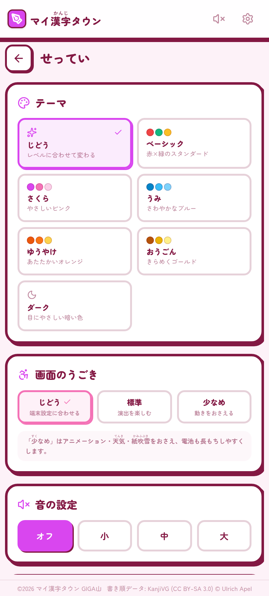

テーマと うごきと 文字の 大きさと 音を えらびます。

### ふりがな・<ruby>音読<rt>おんどく</rt></ruby>チャレンジ・1日の<ruby>量<rt>りょう</rt></ruby>を かえる

「<ruby>学習<rt>がくしゅう</rt></ruby>せってい」には、5つの こうもくが あります。

- 「ふりがな」<ruby>漢字<rt>かんじ</rt></ruby>の上に ひらがなを 出す ところを 3つから えらびます
  - 「すべて」どの <ruby>字<rt>じ</rt></ruby>にも 出します（はじめは これです）
  - 「<ruby>学年<rt>がくねん</rt></ruby>より<ruby>上<rt>うえ</rt></ruby>の<ruby>字<rt>じ</rt></ruby>だけ」ホームで えらんだ <ruby>学年<rt>がくねん</rt></ruby>より 上の <ruby>学年<rt>がくねん</rt></ruby>で ならう <ruby>字<rt>じ</rt></ruby>にだけ 出します
  - 「なし」出しません
  - <ruby>音読<rt>おんどく</rt></ruby>の <ruby>例文<rt>れいぶん</rt></ruby>と、<ruby>書<rt>か</rt></ruby>きとりの ◯の 上の ふりがなは、<ruby>読<rt>よ</rt></ruby>みを ならう ところなので、どれを えらんでも 出ます
- 「<ruby>自動再生<rt>じどうさいせい</rt></ruby>」<ruby>音読<rt>おんどく</rt></ruby>の とき、お手本の <ruby>声<rt>こえ</rt></ruby>を じどうで ながすか どうか
- 「<ruby>音読<rt>おんどく</rt></ruby>チャレンジ」マイクを つかう チャレンジを 出すか どうか
- 「1回のセッションの量」少なめ・ふつう・多め の 3つから えらびます
- 「1日の<ruby>学習目標<rt>がくしゅうもくひょう</rt></ruby>」5字・10字・20字。はじめは 10字です

はじめての ころは「少なめ」と「5字」から はじめると つづけやすいです。
なれてきたら ふやしてください。

<ruby>先生<rt>せんせい</rt></ruby>から ならった はんいが とどいていると、いちばん下に
「ならった<ruby>範囲<rt>はんい</rt></ruby>（<ruby>先生<rt>せんせい</rt></ruby>から）」と「<ruby>範囲<rt>はんい</rt></ruby>を やめる」が 出ます
（上の「<ruby>先生<rt>せんせい</rt></ruby>から『ならった はんい』が とどいたら」を 見てください）。

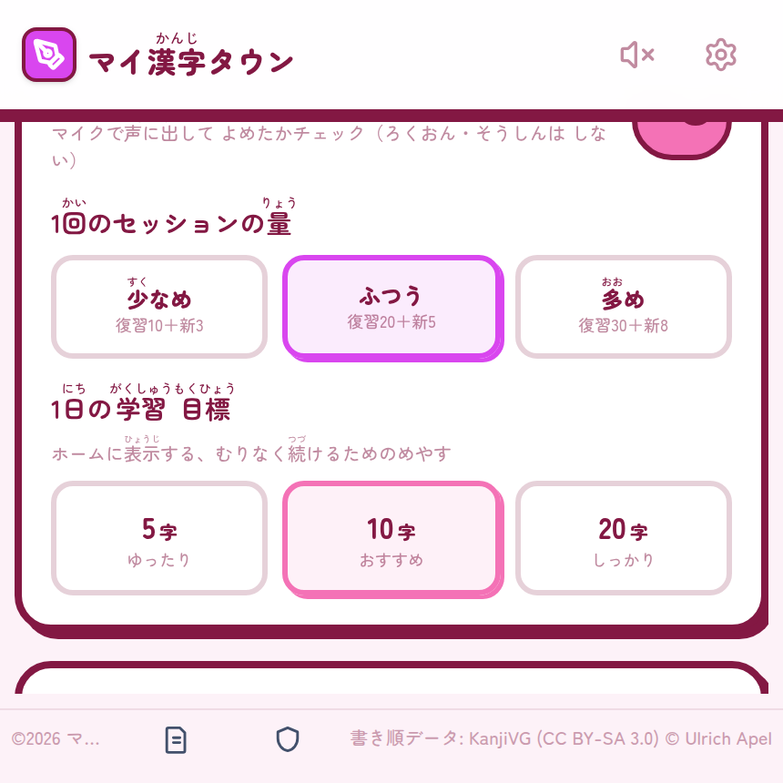

1日の もくひょうは ここで かえます。

## 【重要】ホーム<ruby>画面<rt>がめん</rt></ruby>に 入れて、<ruby>記録<rt>きろく</rt></ruby>を まもる

アプリのように 1回 おすだけで ひらけるように なり、
インターネットが 切れていても つかえるように なります。

それだけでは ありません。ホーム<ruby>画面<rt>がめん</rt></ruby>に 入れておくと、
<ruby>学習<rt>がくしゅう</rt></ruby>の <ruby>記録<rt>きろく</rt></ruby>が 消えにくく なります。
つづけて つかうなら、はじめの日に かならず やっておいてください。

せっていの 下のほうに「ホーム<ruby>画面<rt>がめん</rt></ruby>に入れる」という ところが あります。
やりかたは <ruby>端末<rt>たんまつ</rt></ruby>に よって ちがいます。

### Chromebook や Windows で 入れる

Chrome の ときは、アプリの中の ボタンから 入れられます。

入れかた:

1. 右上の はぐるまから せっていを ひらきます。
2. 下へ さげて「ホーム<ruby>画面<rt>がめん</rt></ruby>に入れる」を さがします。
3. 「ホームに入れる」を おします。
4. たしかめの まどが 出たら、そのまま すすめてください。

アドレスの らんの 右はしに 出る インストールの しるしからでも 入れられます。

### iPad や iPhone で 入れる

Safari には アプリの中の ボタンが ありません。手で ついかします。

入れかた:

1. <ruby>画面<rt>がめん</rt></ruby>の 下（iPad は 右上）の <ruby>共有<rt>きょうゆう</rt></ruby>ボタン（四角に 上むきの やじるし）を おします。
2. メニューを 下へ さげます。
3. 「ホーム画面に追加」を おします。
4. 右上の「追加」を おします。

【！！】iPad と iPhone で 気をつけること:

- iPad と iPhone は、7日間 まったく ひらかないと、<ruby>記録<rt>きろく</rt></ruby>が じどうで 消えることが あります。これは Safari の しくみで、アプリでは とめられません
- ホーム<ruby>画面<rt>がめん</rt></ruby>に 入れておくと、これが 起きにくく なります
- 長い おやすみを はさむ 前には、下の「学習の記録を ほかの端末へ移す」の やりかたで、ひかえを とっておいてください

## マイドリルを 作って くばる（先生向け）

ここからは 先生が つかう ところです。児童だけで つかうときは 読まなくてかまいません。
漢字を えらんで オリジナルのドリルを 作り、学級へ くばることができます。

### ドリルを作って保存する

ホームの「マイドリル」から開きます。まだ 1つも作っていないときは
「ドリルがまだありません」と表示されます。

作成の手順:

1. 右上の「作る」を押してください。
2. いちばん上の欄にドリルの名前を入力してください（例:「1年のふくしゅう」）。
3. 入れたい漢字をさがして、タップしてください。選んだ字は色が変わります。
   さがし方は、この節の下のほうの「漢字のさがし方」を見てください。
4. 画面の下に「◯文字 選択中」と選んだ字が表示されます。数をここで確認してください。
5. 「保存する」を押してください。

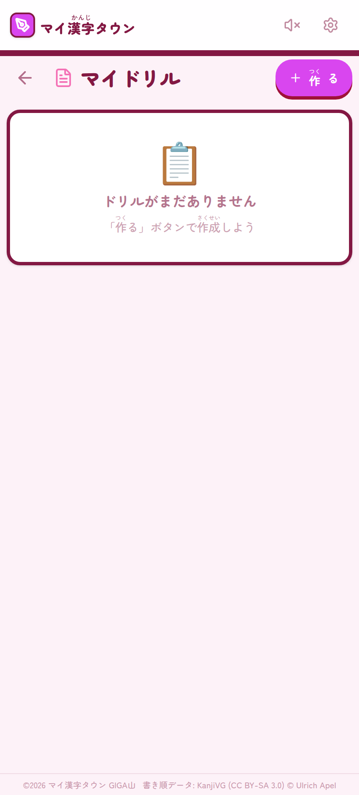

「作る」から始めます。

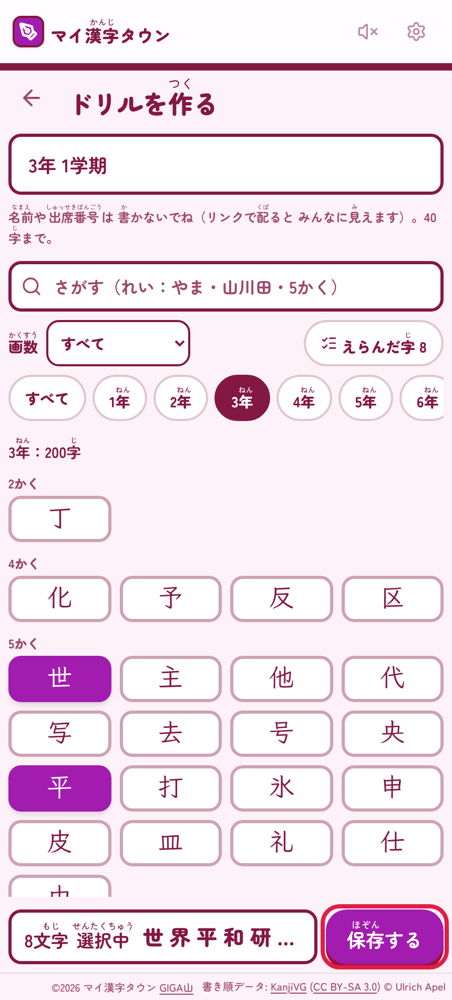

赤い枠の「保存する」で確定します。

【！】覚えておいていただきたいこと:

- 名前を空のままにすると保存できません。かならず入力してください
- はじめは、設定している学年の字が並びます。学年をまたいで選べます。「すべて」のタブから1026字すべてを選べます
- 児童の氏名や学級名を、ドリルの名前に入れないでください。リンクで配ると、その名前も一緒に相手へ渡ります

漢字のさがし方:

字を選ぶ画面では、目当ての字を次の方法でさがせます。
「ならった範囲を配る」の「字をえらぶ」でも、同じようにさがせます。

- 教科書の単元の字を、まとめて入れるとき: 「さがす」の欄に、字をそのまま続けて入力してください（例:「世界平和」）。
  入力した順に字が並びます。「◯字を まとめて えらぶ」を押すと、並んだ字を一度に選べます。
  空白や読点がまじっていてもかまいません
- 読みでさがすとき: ひらがなかカタカナで読みを入力してください（例:「やま」「コウ」）。
  字の下に、当てはまった読みが出ます
- 画数でしぼりこむとき: 「画数」の欄から画数を選んでください。
  「さがす」の欄に「5かく」や「5」と入力しても同じです
- 学年でしぼりこむとき: 学年のタブを押してください。読みでさがしたときに、ほかの学年にも当てはまる字があれば
  「すべての がくねんで 見る」が出ます
- 選んだ字を見直すとき: 「えらんだ字」を押すと、選んだ字だけが並びます。字を押すと外せます（ドリルを作る画面だけ）

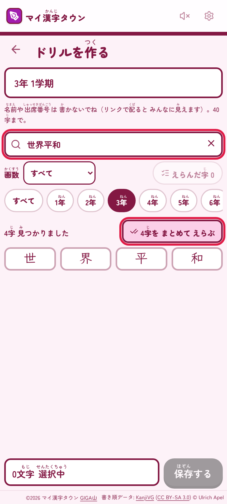

赤い枠の欄に字を入力し、「◯字を まとめて えらぶ」を押します。

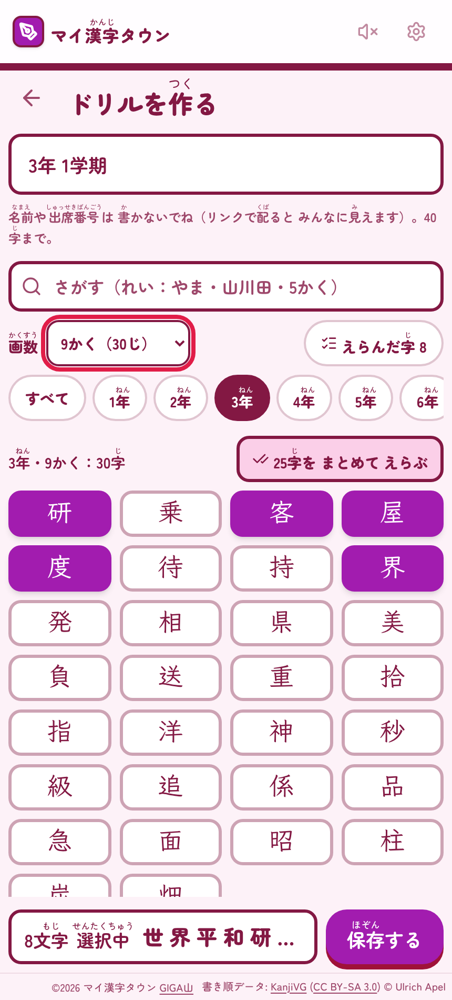

赤い枠の「画数」で、その画数の字だけにしぼれます。

【！】覚えておいていただきたいこと:

- 何も入力していないときは、字が画数の少ない順に並び、画数ごとに見出しが付きます
- 小学校で習わない字を入力したときは、「小学校で習う字にありません」と出ます
- 「まとめて えらぶ」が出るのは、並んだ字が60字までのときです（学年の字をぜんぶ選んでしまう押しまちがいを防ぐためです）

### ドリルでテストをして結果を見る

保存すると一覧にドリルが並び、ドリルごとのボタンが表示されます。
「練習」「テスト」「リンク」「送る」「プリント（先生向け）」「削除」です。
「プリント（先生向け）」は、下の「プリントにして紙で配る」で説明します。

「練習」はお手本を見ながら書く練習、「テスト」は点数のつく本番です。

テストの手順:

1. 「テスト」を押してください。
2. 問題数を選びます。10・20・50・100問のうち、ドリルの字数以下のものと「ぜんぶ（◯問）」が表示されます。
3. 「この「◯」は何の漢字？」と例文が出るので、マスに書いてください。
4. 「答える」を押すと次の問題に進みます。書き直すときは「消す」です。
5. 最後に結果の画面が出ます。

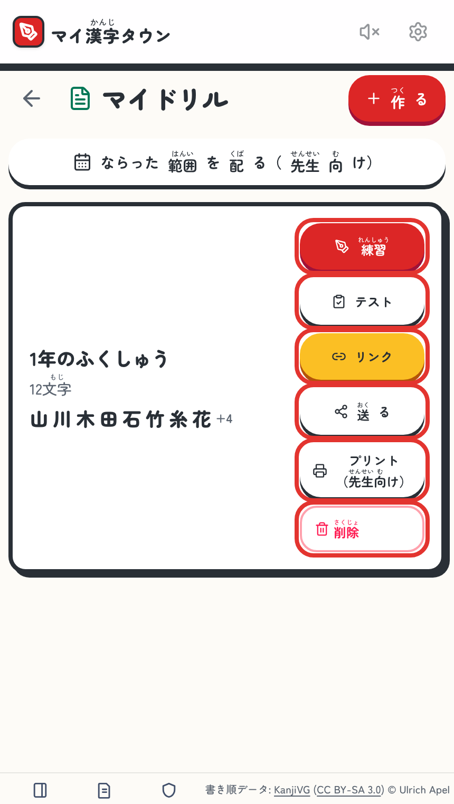

赤い枠の6つが、ドリルごとのボタンです。

ドリルの字数に合わせて候補が変わります。

例文の◯に入る字を書きます。

結果の画面には正答率と、1問ごとのカードが並びます。
カードを押すと「なぜその点数か」が開き、書き順・字形・とめはねの内訳と、
児童の字とお手本を色分けで見比べられます。合格は70点以上です。

まちがえた字だけをそのまま練習に回すこともできます。

カードを押すと点数の内訳が開きます。

### リンクやQRコードで配る（Google Classroom）

一覧の「リンク」を押すと、配布用の画面が開きます。
別の教室や家庭にも渡せる、いちばん確実な方法です。

配布の手順:

1. 「リンク」を押してください。
2. 「URLをコピー」でアドレスを写すか、「Google Classroom で共有する」を押してください。
3. Classroom が開いたら、クラスと「課題」「資料」などを選んで投稿してください。
4. 児童の端末が近くにあるときは、画面の下のQRコードを読み取らせてもかまいません。

下にQRコードも表示されます。

【！】覚えておいていただきたいこと:

- ドリルの中身はURLそのものに入っています。サーバーには保存されません
- リンクを開いた児童は、そのまま自分のマイドリルに保存できます
- あとからドリルを直しても、配ったリンクは変わりません。新しいリンクを配りなおしてください
- URLは長くなります。短くしようとして途中で切らないでください。中身が失われます

配ったものの控え:

リンク・QRコード・Google Classroom・4けたの数字で配ったものは、先生の端末に控えとして残ります（新しい順に20件まで）。
マイドリル画面の「配ったものの控え（先生向け）」から開きます。

- 「リンク・QRを もういちど 出す」: 配ったときの中身のまま、URL・Google Classroom・QRコードをもう一度出せます。
  配ったあとでドリルや範囲を直していても、控えの中身は配ったときのままです
- ならった範囲の控えでは、「この範囲を 直して 配りなおす」で、配った範囲を下書きにもどして直せます
  （いまの下書きは置きかわります）
- ごみ箱のボタンで、控えから消せます（配ったリンクそのものは消えません）

赤い枠のボタンで、配ったリンクとQRコードをもう一度出します。

【！】覚えておいていただきたいこと:

- 控えに残るのは、URLをコピーしたとき・Classroom の共有を開いたとき・4けたの数字で送れたとき・
  リンクを出した画面をはなれたときです
- 控えはこの端末の中だけにあり、サーバーには送りません。記録を書き出すと、控えも一緒に入ります

### 4けたの数字で送る（同じ教室のとき）

同じ教室にいるときは、リンクを配らずに4けたの数字で渡せます。
「リンクで配る」の画面のいちばん下にある
「4けたのすうじで送る（同じ教室のとき）」から始めます。

送り方は、先生の画面に出た4けたの数字を児童に伝え、
児童が「通信でもらう」でその数字を入力する、という流れです。

児童の側の手順:

1. ホームの「通信でもらう」を押してください。
2. 「4けたのすうじをいれてね」と表示されます。数字のボタンで入力してください。
3. QRコードを読み取ってもかまいません。「QRコードでよみとる」から進みます。
4. 受け取ったドリルは、そのままマイドリルに保存できます。

児童はこの画面で4けたを入力します。

【！】覚えておいていただきたいこと:

- この方法は、端末どうしを直接つなぐしくみを使います。学校のネットワークによっては使えません
- つながらないときは、上の「リンクやQRコードで配る」を使ってください。そちらは通信の制限を受けにくい方法です
- うまくいかないときの詳しい対処は、下の「うまく いかないとき」を見てください

### 宿題として配る

「リンクで配る」の画面で「宿題にする（先生向け）」に印を付けると、ドリルを宿題として配れます。
リンク・QRコード・Google Classroom・4けたの数字のどれで配っても、同じ宿題が届きます。

宿題の手順:

1. マイドリル一覧の「リンク」を押してください。
2. 「宿題にする（先生向け）」に印を付けてください。
3. 「しめきり」の日を選んでください（はじめは1週間後になっています）。
4. 「やること」で「練習」か「テスト」を選んでください。
5. テストのときは、問題数（10・20・50問・ぜんぶ）と合格の目安（60〜100%）を選んでください。
6. 下のURLをコピーするか、「Google Classroom で共有する」を押してください。4けたの数字で送るときは、いちばん下のボタンから進みます。

赤い枠の中で、しめきり・やること・問題数・合格の目安を決めます。

児童の端末では、ホームに「しゅくだい」としめきりが出ます。
練習はドリルの字をぜんぶ練習すると、テストは合格の目安以上の点になると「できた」になります。

【！】覚えておいていただきたいこと:

- サーバーがないので、児童の結果は先生の端末には届きません。児童が終わったあとの画面の「先生に見せる」で、ドリルの名前・点数・できた日を見せます。児童の名前は出ません
- 結果（いちばんよかった点・できた日・回数）は、その児童の端末のマイドリルに残ります
- しめきりを過ぎても、児童はそのまま取り組めます。画面では責めない言い方で知らせます
- 決まりを変えたいときは、選び直して新しいリンクを配ってください。しめきりなどが違えば、別の宿題として届きます。同じリンクを2回開いても、宿題は1つのままです
- 古い版のアプリでリンクを開いた場合は、ふつうのドリルとして受け取ります

### プリントにして紙で配る（先生向け）

端末を家に持ち帰れない児童にも、アプリと同じ字・同じ例文の漢字テストを紙で渡せます。
一覧の「プリント（先生向け）」から、1分ほどで作って印刷できます。
紙は教室の漢字テストと同じ縦書きで、A4縦の1枚に10問です。

作り方の手順:

1. 一覧の「プリント（先生向け）」を押してください。
2. 「種類」を選びます。「書き取り」は例文の中の字が□になり、□の右に読みがなが付きます。「読み」は字の右に線が引かれ、その右に読みがなを書かせます。「両方」は、読みのページのあとに書き取りのページが続きます。
3. 「問題の数」を選びます。10問・20問のうちドリルの字数より少ないものと、「ぜんぶ」が出ます。「両方」のときは、読みと書き取りがそれぞれこの数になります。
4. 「順番」を選びます。「ドリルの順」はドリルの初めから順に、「ばらばら」は混ぜた順に並びます。並びを変えたいときは「並べなおす」を押してください。
5. 「答えのページ」を「つける」にすると、答えを赤で書き入れたページが、問題のページのあとに付きます。
6. 見本で仕上がりを確かめて、「印刷する」を押してください。印刷の画面が開きます。

赤い枠のボタンから始めます。

選んだら、赤い枠の「印刷する」を押します。

印刷の画面では、次のことを確かめてください。

1. 用紙を A4、向きを縦にしてください。
2. 倍率は「既定」（100%）のままにしてください。合わせて縮めると、□が小さくなります。
3. 「ヘッダーとフッター」はオフにしてください。オンのままだと、紙の端に日付とアドレスが入ります。
4. 紙に刷らずにファイルにしたいときは、送信先で「PDFに保存」を選んでください。ファイルの名前にはドリルの名前が入ります。

左が問題のページ、右が答えのページです。

【！】覚えておいていただきたいこと:

- 例文は、アプリの毎日のテストと同じ例文の中から選びます。アプリで練習した文と同じ形で出ます
- 紙のふりがなは、設定の「ふりがな」にかかわらず、すべて付きます
- 名前の欄は空いています。児童が手で書きます。アプリは名前を保存しません
- 「両方」のときは、読みのページに書き取りの答えの字が見えます。読みのページと書き取りのページは、時間を分けて配るか、別々に回収してください
- 「ドリルの順」なら、何度作っても同じ問題になります。「ばらばら」は、選ぶたびに並びが変わります
- 紙のテストの結果は、アプリの学習の記録には入りません
- 書き順のプリントはありません。書き取りと読みだけです

### <ruby>紙<rt>かみ</rt></ruby>の テストに こたえる

先生から <ruby>紙<rt>かみ</rt></ruby>の テストを もらったら、つぎのように 書きます。

かきかた:

1. いちばん上の「なまえ」の よこに、じぶんの なまえを 書きます。
2. もんだいは、<ruby>右<rt>みぎ</rt></ruby>の 1ばんから <ruby>左<rt>ひだり</rt></ruby>へ じゅんに すすみます。上から 下へ 読みます。
3. □が ある もんだいは、□に 入る <ruby>漢字<rt>かんじ</rt></ruby>を 書きます。□の <ruby>右<rt>みぎ</rt></ruby>の 小さな 字が、そのことばの 読みかたです。
4. 字の <ruby>右<rt>みぎ</rt></ruby>に <ruby>線<rt>せん</rt></ruby>が ある もんだいは、その ことばの 読みかたを、<ruby>線<rt>せん</rt></ruby>の <ruby>右<rt>みぎ</rt></ruby>に ひらがなで 書きます。

【！】おぼえておいて ほしいこと:

- アプリで <ruby>練習<rt>れんしゅう</rt></ruby>した 文と おなじ 文が 出ます
- わからない ところは あけておいて、さいごに もう<ruby>一度<rt>いちど</rt></ruby> 見なおしましょう

### ならった範囲を前もって配る（先生向け）

授業で習った字だけを、児童の毎日の学習の「新出」（はじめて習う字）に出すしくみです。
1週目・2週目…のように段に分け、段ごとに「この日から」を決めて、前もってまとめて配れます。
復習は今までどおり、習ったすべての字から出ます。

マイドリル画面の「ならった範囲を配る（先生向け）」から開きます。

作成の手順:

1. 「範囲の名前」を入力してください（例:「3年 2学期」）。
2. 1だんめの「この日から」を選び、「字をえらぶ」で字をさがしてタップしてください。字をそのまま入力する・読み・学年・画数でさがせます（「ドリルを作って保存する」の「漢字のさがし方」）。選び終えたら「できた」を押します。
3. 「だんを足す」で段を増やします。日付には前の段の1週間後が入ります。
4. マイドリルがあるときは、段の「マイドリルから」でそのドリルの字を足せます。「マイドリルから だんを作る」では、選んだドリルを1つずつ段にします。
5. 段に並んだ字を押すと、その字を段から外せます。
6. 下の「リンクを作る」を押してください。

ほかの段に入れた字には段の番号が付き、選べなくなります。

赤い枠が1つの段です。段ごとに「この日から」と字を決めます。

段の字をそのまま使う:

字を入れた段には「この だんの字を つかう」として、3つのボタンが出ます。字を選びなおさずに、週の小テストや授業に使えます。

- 「マイドリルに する」: その段の字で、マイドリルを1つ作ります（名前は「範囲の名前 ◯だんめ」）。
  テスト・宿題・4けたの数字で送る は、マイドリルからできます。同じ段でもう一度押しても、2つめは作りません
- 「プリントに する」: その段の字の、紙のテストを作る画面が開きます（「プリントにして紙で配る」と同じ画面です）。
  左上の矢印で、範囲の画面にもどります
- 「授業で うつす」: その段の字を、電子黒板に大きく映す画面が開きます（すぐ下の「授業で映す」を見てください）

赤い枠のボタンで、その段の字をマイドリル・プリント・授業に使います。

授業で映す（授業モード）:

電子黒板やプロジェクターに字を1字ずつ大きく映し、読み・書き順・使い方を見せられます。
範囲の段の「授業で うつす」か、マイドリルの「授業で うつす（先生向け）」から開きます。

- 「つぎの 1かく」: 押すたびに1画ずつ進みます。空書きの「いち、にい、さん」のかけ声に合わせて押してください。
  いま書いた画の色が変わり、番号が付きます
- 「じどうで 書く」: 1画めから自動で書きます。「とめる」で止まります
- 「1かく もどる」「はじめから」: 1画もどします・何も書いていないところから始めます
- 「字を かくして たしかめる」: 字を「？」にして、例文の字を◯にします。
  書けるかを確かめたら「こたえを 見る」を押してください
- 上に並んだ字か、下の「まえの字」「つぎの字」で、字を移ります
- 右上の「全画面」で、ブラウザのわくを隠せます
- キーボードやプレゼン用のリモコンでも動かせます（→ か PageDown: 次の字、← か PageUp: 前の字、
  スペースか Enter: 次の1画、Esc: とじる）

赤い枠の「つぎの 1かく」を、かけ声に合わせて押します。

授業モードは映すだけです。学習の記録は付かず、どこへも送りません。

配る手順: 「リンクを作る」を押すと、配る画面になります。
URLをコピーするか、「Google Classroom で共有する」を押してください。URLが短いときはQRコードも出ます。

児童がリンクを開くと、確かめの画面のあとで範囲が使われます。
日付が来た段の字だけが、段の順に新出に出ます。ホームには範囲の名前と、次の段がいつから出るかが出ます。

赤い枠のURLを配ります。

【！】覚えておいていただきたいこと:

- サーバーがないので、全部の段と日付をリンクの中に入れて配ります。児童の端末が自分の日付を見て、日付が来た段の字を出します。端末の日付がずれていると、出る日もずれます
- 児童の画面には日付の前の段の字は出ませんが、リンクの中身を読み解けば、日付の前の字もわかります。字を隠しておきたい使い方には向きません
- 範囲は1人の端末に1つです。新しいリンクを開くと、確かめたうえで置きかわります。直したときは新しいリンクを配りなおしてください
- 範囲を使っている間は、ホームで学年のボタンを変えても、新出は範囲の字から出ます（復習・マイドリル・ボスバトルなどは今までどおりです）。範囲に無い学年をえらぶと、ホームにそのことが出ます
- 範囲の字をすべて習うと、児童がえらんだ学年の字が新出に出るように戻ります。児童は設定の「範囲を やめる」でいつでもやめられます
- 1つの範囲は40段・300字までです。リンクが1800字を超えると「長くなっています」と出ます。そのときは学期ごとなどに分けて配ってください（目安: 1学期分の70字・12段で約600字、1年分の200字・35段で約1600字）
- 作りかけの範囲は、先生の端末に下書きとして1つ残ります。「下書きを消して はじめから作る」で消せます
- 範囲の名前には、学級名や児童の名前を書かないでください。リンクを開いた人みんなに見えます
- 4けたの数字では送れません。リンクかQRコードで配ってください

## 学習の記録を ほかの端末へ移す（先生向け）

記録はその端末の中だけに保存されます。端末が変わると引き継がれません。
学年が上がるときや、端末を入れ替えるときは、この手順で移してください。

### 記録を書き出して読み込む

設定（画面右上のはぐるま）の「データ管理」から行います。
この欄には、いま使っている容量、覚えた漢字の数、学習中の漢字の数も表示されます。

移す手順:

1. 元の端末で設定を開き、「データ管理」まで画面を下げてください。
2. 「エクスポート」を押してください。日付の入ったファイルが1つ保存されます。
3. そのファイルを、新しい端末から開ける場所に置いてください。
4. 新しい端末で設定を開き、「インポート」を押してファイルを選んでください。
5. 確認の画面が出たら「実行する」を押してください。

エクスポートとインポートはここにあります。

【！】覚えておいていただきたいこと:

- インポートすると、その端末の今の記録は上書きされます。先に元の端末で書き出しておいてください
- 書き出したファイルには氏名やメールアドレスは含まれません。学習の進み具合だけです
- ブラウザーの履歴やサイトデータを消すと、記録も一緒に消えます。学期の区切りで書き出しておくと安全です

### 【！！】すべてのデータを消す

同じ「データ管理」の下に「すべてのデータを消す」があります。
漢字の進み具合・まちのデータ・実績が、すべて消えます。

この操作は取り消せません。もとに戻す方法はありません。
実行する前に、かならず「エクスポート」で控えを取ってください。

共用の端末を次の学年に引き渡すときなど、本当に消してよいと判断したときだけ使ってください。
押すと確認の画面が出ます。やめるときは「やめる」を押してください。

## うまく いかないとき

こまったときは、この中から 近いものを さがしてください。
それでも なおらないときは、いちばん下を 見てください。

### <ruby>画面<rt>がめん</rt></ruby>が 白いまま／<ruby>表示<rt>ひょうじ</rt></ruby>が くずれている

<ruby>画面<rt>がめん</rt></ruby>を もう一度 よみこんでください。
ブラウザーの こうしんの ボタン、または キーボードの F5 です。

それでも なおらないときは、いちど タブを とじて、もう一度 ひらいてください。

### 「あたらしい バージョンが あります」と 出た

<ruby>画面<rt>がめん</rt></ruby>の 下に この おしらせが 出たら、よこの「さいしんに する」を
おしてください。すぐに 新しい ものに かわります。

<ruby>学習<rt>がくしゅう</rt></ruby>の とちゅうでも、<ruby>記録<rt>きろく</rt></ruby>は きえません。
急いでいるときは、そのまま つづけて、あとで おしても かまいません。

### <ruby>書<rt>か</rt></ruby>き<ruby>順<rt>じゅん</rt></ruby>の お手本（うすい字）が 出てこない

<ruby>書<rt>か</rt></ruby>き<ruby>順<rt>じゅん</rt></ruby>の データと 文字の かたち（書体）は、アプリの 中に 入っています。
学校の ネットワークで とめられることは ありません。
はじめて ひらいたあと、アプリが うらで 1〜6年 ぜんぶの データを <ruby>端末<rt>たんまつ</rt></ruby>に のこします。

それでも 出ないときは、ページを 一度 よみなおしてください。
その字だけ 出ないときは、「この字は あとで」で とばして、<ruby>音読<rt>おんどく</rt></ruby>だけ つづけられます。

### 4けたの <ruby>数字<rt>すうじ</rt></ruby>で <ruby>送<rt>おく</rt></ruby>れない／QRが 出ない

4けたの 数字で 送る しくみは、<ruby>端末<rt>たんまつ</rt></ruby>どうしを
<ruby>直接<rt>ちょくせつ</rt></ruby> つなぎます。
学校の ネットワークで とめられていると、下のように「エラーがおきました」と 出ます。

こう出たときは 下の やりかたを ためしてください。

このときは「リンクで<ruby>配<rt>くば</rt></ruby>る」を つかってください。
リンクと QRコードは、この しくみを つかわないので、<ruby>通<rt>とお</rt></ruby>りやすい
やりかたです。

4けたの 数字で 送る しくみを つかうときだけ、学校の <ruby>情報担当<rt>じょうほうたんとう</rt></ruby>の先生に、
つぎの アドレスを <ruby>通<rt>とお</rt></ruby>してもらう ひつようが あります（ほかの きのうでは いりません）。

- 0.peerjs.com（へやの 番号を やりとりする）
- stun.l.google.com と eu-0.turn.peerjs.com と us-0.turn.peerjs.com（端末どうしを つなぐ）

QRコードを 出す しくみは アプリの 中に 入っているので、アドレスの きょかは いりません。

### しゅくだいの けっかが <ruby>先生<rt>せんせい</rt></ruby>の <ruby>端末<rt>たんまつ</rt></ruby>に 出ない

サーバーを つかわない しくみなので、<ruby>児童<rt>じどう</rt></ruby>の けっかは <ruby>先生<rt>せんせい</rt></ruby>の <ruby>端末<rt>たんまつ</rt></ruby>には とどきません。
おわったあとの <ruby>画面<rt>がめん</rt></ruby>の「<ruby>先生<rt>せんせい</rt></ruby>に<ruby>見<rt>み</rt></ruby>せる」を おして、見せてもらってください。
マイドリルの 一覧でも、しゅくだいの ようすと いちばん よかった <ruby>点<rt>てん</rt></ruby>を 見られます。

### <ruby>音読<rt>おんどく</rt></ruby>チャレンジで マイクが はんのうしない

はじめて つかうとき、ブラウザーが「マイクを つかっても いいですか」と きいてきます。
ここで「きょか」を えらばないと つかえません。

まちがえて ことわったときは、アドレスの よこの かぎの しるしから きょかしなおせます。
それでも だめなときは、せっていの「<ruby>音読<rt>おんどく</rt></ruby>チャレンジ」を
オフに してください。
オフでも <ruby>学習<rt>がくしゅう</rt></ruby>は さいごまで すすめられます。

<ruby>声<rt>こえ</rt></ruby>は ろくおんされません。どこにも <ruby>送<rt>おく</rt></ruby>られません。

### 字を <ruby>書<rt>か</rt></ruby>いても <ruby>線<rt>せん</rt></ruby>が 出ない

ゆびを ますの 中から はじめてください。ますの そとからは 書けません。
また、2本の ゆびが <ruby>画面<rt>がめん</rt></ruby>に ついていると 書けません。1本で 書いてください。

なぞる ときは、書きはじめの ばしょが 合っていないと <ruby>線<rt>せん</rt></ruby>が 出ません。
「かきはじめが ちがうよ」と 出たら、うすい字の はじまりの ところから 書きなおしてください。

### <ruby>記録<rt>きろく</rt></ruby>が きえてしまった

<ruby>記録<rt>きろく</rt></ruby>は その <ruby>端末<rt>たんまつ</rt></ruby>の 中だけに あります。
つぎの ときに 消えます。

- ブラウザーの りれきや サイトのデータを 消したとき
- ちがう <ruby>端末<rt>たんまつ</rt></ruby>や ちがう ブラウザーで ひらいたとき
- プライベートモード（シークレットモード）で ひらいたとき

消えた <ruby>記録<rt>きろく</rt></ruby>を もどす ほうほうは ありません。
先生に たのんで、ときどき「エクスポート」で ひかえを とっておくと あんしんです。

### <ruby>長<rt>なが</rt></ruby>い おやすみの あと、まちが あれている

こわれては いません。ながく ひらかないと、まちは わざと あれるように なっています。

<ruby>学習<rt>がくしゅう</rt></ruby>を すると、その場で くさは とれます。
へった 人や もどった <ruby>建物<rt>たてもの</rt></ruby>は、また
<ruby>学習<rt>がくしゅう</rt></ruby>を つづけると もどってきます。

### それでも なおらないとき

まず、この アプリを 教えてくれた 先生か、学校の
<ruby>情報担当<rt>じょうほうたんとう</rt></ruby>の先生に そうだんしてください。
同じ <ruby>端末<rt>たんまつ</rt></ruby>を つかっている ほかの人にも 同じことが 起きているかを 見ると、
<ruby>端末<rt>たんまつ</rt></ruby>の もんだいか、ネットワークの もんだいかが わかります。

先生が しらべるときは、せっていの いちばん下にある
「アプリの状態とサポート」を 見てください。
<ruby>端末<rt>たんまつ</rt></ruby>の ほぞん量、<ruby>通信<rt>つうしん</rt></ruby>の ようす、
アプリの <ruby>版<rt>はん</rt></ruby>、マイクが つかえるか、エラーの 回数が ならんでいます。

「診断ファイルを保存」を おすと、この ようすを 1つの ファイルに できます。
このファイルには、<ruby>漢字<rt>かんじ</rt></ruby>の <ruby>学習内容<rt>がくしゅうないよう</rt></ruby>・
<ruby>氏名<rt>しめい</rt></ruby>・メールアドレス・パスワードは 入りません。

先生が しらべるときは ここを 見ます。

それでも わからないときは、このページの 下に ある 問い合わせ先へ ご連絡ください。
そのとき、上の 診断ファイルを 一緒に 送っていただけると、原因が 早く わかります。
